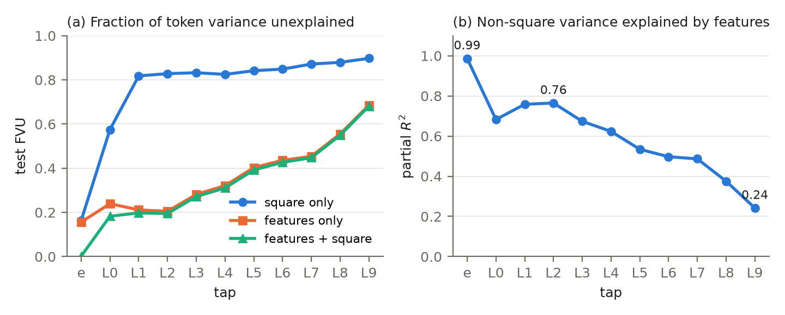
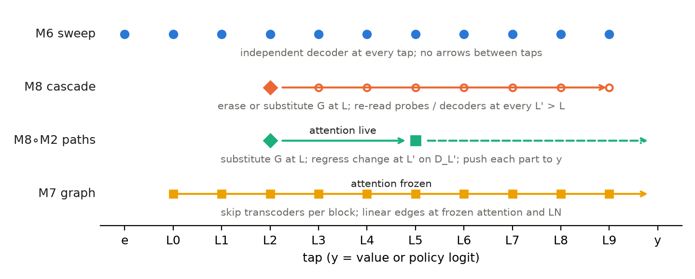

# Attributing a Chess Transformer's Outputs to a Fixed Human Feature Vocabulary: Decoders, Probes, and What the Vocabulary Misses

xai-chess project

## Abstract

Explaining a network in chess terms needs a map from concepts to activations and a removal rule. For the Leela Chess Zero (lc0) transformer, ridge decoders from 30,837 rule-computed per-square features to each square token leave 0.002 of token variance unexplained at the embedding and 0.680 at the last block. This paper asks which methods turn such maps into attributions of lc0's value and policy outputs, and what the vocabulary leaves unnamed. Only the fits, bit counts and the exported graph were measured. Methods and outcomes are proposals from a survey of 89 works. The embedding is local to each square, so decoder gradients, integrated gradients and feature occlusion there all reduce to input saliency in feature names. At later layers, patching the decoded change of a real board edit attributes that edit, a named/residual split measures coverage, and four compositions combine layers. Only an edit's joint effect is identifiable, not its split among collinear feature families. The recommended first experiment runs both methods on about 1,000 pin-edit pairs at five layers with random-initialisation and ridge controls, costs an estimated two CPU hours, and has numeric decision rules fixed in advance.

*Keywords:* concept-based explanation, activation patching, causal abstraction, Shapley values, identifiability, mechanistic interpretability, Leela Chess Zero

## 1. Introduction

A chess network's evaluation can be explained in chess terms only through a map from its internal state to those terms. The xai-chess project has two such maps. A Rust extractor (`features/square/`) emits for every square a binary vector of 30,837 bits: occupant, pawn structure, x-rays, threats, routes, piece roles, castling rights on the king, and mate and material lines computed with an engine. About 36.5 bits are on per square. On 20,000 Lichess puzzle positions, split 80/20 by position, probes read these features from lc0's square tokens ($d=256$), and decoders predict the token from the features plus a one-hot square identity. Both were fitted at the embedding and at each of the ten encoder blocks.

Attribution of an output to features is easiest to define where the decoder fits well and where the path to the output is short. On lc0 these places sit at opposite ends of the network. The project's working note frames this as a dilemma. At the back, reconstruction is near-perfect but mostly square identity, and attribution must pass through "the deep jungle of attention". At the front, attribution is clearer. The note asks whether a hybrid helps. The measured fits at the two ends are as follows. Square identity alone leaves FVU 0.164 at the embedding and 0.897 at block 9. Features plus square identity leave 0.002 and 0.680. Table 2 gives every tap.

This paper answers one question. *Which methods can attribute lc0's value and policy outputs to a fixed per-square feature vocabulary through learned feature–activation maps, and how do they trade off faithfulness under intervention, identifiability, residual coverage and compute on this system?* The question has three parts, each posed in the working note: (a) attribution through the decoder at the embedding, (b) attribution through decoders and encoders at any layer, and (c) methods that combine several maps across layers. A fourth request is a first experiment.

The maps alone do not give an attribution. A probe shows that information is present at a tap, not that lc0 uses it [1], [2], and a decoder fit says how much token variance the vocabulary explains, not how much of an output change runs through it. Attribution needs a removal rule and an output [3]. The project gives priority to what the vocabulary misses, so every method below reports a residual beside its named part.

The contribution is an assembly of existing pieces for this system, not new theory.

1. A reduction: at the embedding, decoder gradients, integrated gradients and feature occlusion are all input saliency in feature names (Sections 5.2 and 6).
2. One token decomposition, $h_L=q_L+\sum_G n^G_L+\varepsilon_L$, read by five removal operators at any tap, with one coverage definition. For complete pairwise methods the usual faithfulness error coincides with the residual share, so coverage replaces it (Sections 7 and 9.2).
3. Four cross-layer compositions with their costs, including a feature-path composition that keeps attention live (Section 8).
4. A statement of what is identifiable on this vocabulary (Section 9.1).
5. A protocol for preregistration, with a first experiment of about two CPU hours and numeric decision rules (Section 10).

The measured inputs are the existing fits and extractor bit counts (Tables 1, 2 and 5). Everything else is analysis or hypothesis. Section 2 gives the answer, and Sections 3 to 10 the evidence.

## 2. The Answer in Brief

### 2.1 (a) Through the embedding decoder

The embedding computes each square's token from that square's 112 input values alone, through an elementwise nonlinearity (Section 5.2, read from the ONNX graph). A decoder that fits it at FVU 0.002 shows that the vocabulary contains occupancy. Three forms of attribution run through it: the decoder gradient (M1a), integrated gradients between real boards (M1b) and occlusion of feature families or bits (M1c). All three are input saliency on a square's planes, renamed into features. Non-local families such as x-rays and routes receive spurious credit at the embedding that the residual cancels exactly, so the admissible vocabulary there is local (control C2). Under C2 the named share is predicted to be near 1 by construction (H1). Whether the 0.002 reflects anything learned is a random-initialisation check (C1). See Section 6.

### 2.2 (b) Through decoders and encoders at any layer

Decoded substitution (M2) patches the decoded change of a real board edit into the token at tap $L$ and runs the rest of the network. Its consistency gap $\gamma_L$ measures how far the decoded edit is from the real one. The named/residual split (M6) symmetrises M2 into an exact two-player Shapley value. Its aggregate $\rho_L$ is a two-player attribution and a coverage measure: it does not say which family moved the output, and it guides where per-family attribution (M2, M9) is worth running. The encoder direction tests whether readable content is used, by LEACE erasure (M3), a family-level concept gradient (M4) and interchange alignment (M5). A feature surrogate (M0) is the correlational floor. A policy logit depends on two tokens at the heads' input, which permits an exact four-player split. See Section 7.

### 2.3 (c) Combining layers

The M6 sweep compares independent decoders on one output change. The erasure cascade (M8) intervenes at one layer and reads later layers. Feature paths (M8∘M2) substitute at one layer, read the change at a later layer through that layer's probe and decoder, and push each part to the output with attention live. A supervised replacement graph (M7) chains block-level transcoders with error nodes but freezes attention. A residual budget (M12) splits what remains by cause, and M11 compares methods without fusing them. See Section 8.

### 2.4 Identifiability

The joint effect of a real edit, the consistency gap and the named share are identifiable given the decoder. Its split among collinear families is not. A pin edit changes over 300 bits in 12 or 13 of the 28 families (Table 5). Section 9 gives the remedy and the coverage definition.

### 2.5 First experiment

Run M2 and M6 on about 1,000 pin-edit pairs at the embedding (local vocabulary), L2, L5, L8 and L9, with C1 on three random networks, a ridge sweep (C3) and M0 on the same pairs. It costs an estimated two CPU hours under ONNX, refits included. Numeric decision rules fixed in advance promote M8 and M8∘M2, or M5, or M12 (Section 10.5).

**Table A**
*Methods by sub-question: the question each answers, its residual, and its cost*

| Part | Method | Question answered | Residual reported | Identifiable | Cost (ONNX unless "port") |
|---|---|---|---|---|---|
| (a) | M1a decoder gradient at $e$ | which square inputs, named, move $y$ | $\langle\nabla y,\varepsilon_e\rangle$ | joint only | port; 1 backward pass per position |
| (a) | M1b board-path IG at $e$ | the same, complete over a real pair | $\mathrm{IG}_\varepsilon$ | joint only | port; about 32 backward passes |
| (a) | M1c feature occlusion at $e$ | effect of replacing a family's decoded share | $g_e(q_e)-g_e(q_e+\varepsilon_e)$ | joint only | $m{+}1$ passes per position |
| (b) | M0 feature surrogate | which families predict $y$ | $y-s$ | no (regulariser) | minutes |
| (b) | M2 decoded substitution | effect of the decoded edit; consistency | $\gamma_L$ | joint yes | $2k{+}1$ suffix passes per tap |
| (b) | M6 named/residual split | named share of a real change | $\phi^{(L)}_\varepsilon$, $1-\rho_L$ | yes, given $D_L$ | 1 pass per tap beyond M2 |
| (b) | M9 family Shapley + error | per-family share of a change | $\varphi_\varepsilon$ | joint only | about 30 s per position per tap |
| (b) | M10 relevance chain | the M9 split from one relevance pass | $R^\varepsilon_L$ | rule-dependent | port; 1 modified backward pass |
| (b) | M3 LEACE erasure | is $G$'s linear content used downstream | output after erasing all families | yes | 1 affine patch |
| (b) | M4 concept gradient | sensitivity of $y$ to family probe coordinates | $\|\rho^\perp\|^2/\|\nabla y\|^2$ | min-norm only | port; 1 backward pass |
| (b) | M5 interchange alignment | does a subspace mediate $G$ | $1-$IIA | up to rotation | port; hours |
| (c) | M8 erasure cascade | where named content is built or lost | $\Delta\phi_\varepsilon$ | as M3 or M2 | 1 pass per $(G,L)$ |
| (c) | M8∘M2 feature paths | through which families at $L'$ the effect reaches $y$ | $\pi_{G\to r}$ | joint only | hundreds of passes per pair |
| (c) | M7 replacement graph | along which routes, with attention frozen | error nodes | regulariser-dependent | port; seconds per position |
| (c) | M12 residual budget | why the residual exists; is it nameable | $\eta_L$ | no (SAE size) | CPU hours |
| (c) | M11 disagreement map | do methods and taps agree | coverage spread | nothing fitted | negligible |

*Note.* $k$ is the number of changed families, $m=28$ the number of families. "Joint only" means the joint effect of an edit is identifiable and per-family splits are not. Full taxonomy in Appendix C, method definitions in Appendix A.

Controls C1 to C9 are listed in Appendix B. Sections 3 to 5 give the setting and the constraints these answers rest on.

## 3. System, Data and Notation

### 3.1 Model, taps, inputs and targets

The network is lc0 `t1-256x10-distilled-swa-2432500`: 64 square tokens of width 256, ten post-LayerNorm encoder blocks with eight heads and smolgen attention biases, and policy, value and moves-left heads. It runs as ONNX on CPU at about 180 positions per second. The embedding tap is `/attn_body/rehape`. Block taps L0 to L9 are each block's first LayerNorm output, `/encoder{i}/ln1`, taken after attention and its skip connection and before the feed-forward network. The heads read `/encoder9/ln2`. L0 is the first tap at which a token can carry information from other squares. The ONNX Runtime inference build used here has no backward pass, so gradient methods need a PyTorch port.

Positions are Lichess puzzle FENs, which carry no move history. The input planes therefore use lc0's fen-only history fill (`lc0-probe/lc0_planes.py`). All eight history frames hold the current board, an en-passant pawn is moved back in the older frames, and the repetition planes are zero. Castling rights (four planes), side to move, the rule-50 count and two constant planes are broadcast to all 64 squares. lc0 sees the board from the side to move, and the labels follow it: black-to-move positions are colour-mirrored before extraction (`lc0-probe/square_probe.py`), so "white" in a bit name means the side to move. The plane that tells lc0 that Black is to move (`lc0_planes.py`, plane 108) is carried by no feature. The extractor puts castling rights on the king's square (`king.castle`, commit 473b3ce), and the decoder fits postdate that commit.

The value target is $y=\ell_W-\ell_L$, the difference of the win and loss logits entering the WDL softmax at `/value/dense2`, from the side to move's view. The policy target is the pre-softmax logit of one move (Section 7.4).

**Table 1**
*Existing results other than the per-tap decoder fits (held-out positions, own measurements)*

| Result | Value |
|---|---|
| Linear probe, token at layer $L$ to its own features | most families near-perfectly readable at the embedding; `pawn_cover`, strong squares, mate and passed pawn gain 0.04–0.14 by L5 |
| MLP decoder, features + square to token | trend similar to ridge (Table 2) |
| Board-level decoder, all 64 squares' features to value-head activations and value output | test FVU 0.52–0.62 at 151k positions, still falling with data |
| Value head applied to decoded L9 tokens | test FVU 0.81 at `/value/dense2` (0.88 at `/value/dense1`), against 1.54 (1.34) from square identity alone; 3,960 held-out of 20,000 positions |
| MLP probe for "pin is relevant" | peak AUROC 0.945 at block 8, against 0.839 for Stockfish NNUE |

*Note.* Per-square decoders keep the 14,565 bits with at least 20 positive training tokens. The board-level decoder keeps 17,831 bits.

The project also has exact causal operators in a patched Stockfish. MaskPinner removes the rule-level effect of a pin, and LineBlocker places a ray-selective phantom blocker on a line. They supply interventional ground truth about chess, kept separate from ground truth about lc0 (Section 10.1).

### 3.2 Notation and the canonical split

Let $x$ be a board, $x'$ a real edit of it, and $x_0$ a baseline board from a pool $\mathcal B$ of real positions. The extractor gives $f=\phi(x)\in\{0,1\}^{64\times K}$, with $f_s$ the bits of square $s$ and $\tilde f_s=f_s-\bar f_s$ their per-square centring. Bits are grouped into $m=28$ families $\mathcal G=\{G_1,\dots,G_m\}$, the extractor's top-level name prefixes (`occupant`, `route`, `xray`, …). "Family" means this grouping throughout. The token at tap $L\in\{e,0,\dots,9\}$ is $h_L\in\mathbb R^{64\times256}$, and the suffix network from $L$ to the output is $g_L$. A *decoder* maps features to a token:

$$D_L(f_s,s)=q_{L,s}+W_L\tilde f_s,$$

with $q_{L,s}$ the per-square mean. A *probe* $P_L:h_{L,s}\mapsto\hat f_s$ maps a token to features. Probe-side methods form the *encoder direction*. In that phrase "encoder" means a probe, never an lc0 encoder block. Writing $n_{L,s}=W_L\tilde f_s$ for the named part, $n^G_{L,s}=W^G_L\tilde f^G_s$ for family $G$'s share, and $\varepsilon_{L,s}=h_{L,s}-D_L(f_s,s)$ for the residual, every token splits as

$$h_L=q_L+\sum_G n^G_L+\varepsilon_L.$$

The residual is the error node: what the vocabulary misses at $L$ on $s$. An *attribution* assigns a share of an output quantity to the players $n^G$ and $\varepsilon$ under a stated removal rule.

Because $q_{L,s}$ depends only on $s$, it is identical for $x$ and $x'$ and cancels in every two-board comparison. In the point gradient form (M1a) it does not cancel and is left unassigned. Write $\Delta^{\rm true}=y(x')-y(x)$ for lc0's response to a real edit. Pairs are *oriented* so that $\Delta^{\rm true}\ge0$: if an edit lowers $y$, $x$ and $x'$ are swapped.

With the notation fixed, Section 4 states what the literature allows these maps to support.

## 4. What the Literature Constrains

### 4.1 The removal rule decides what an attribution means

Covert et al. [3] classify 26 explanation methods by how they remove features. Conditional, interventional and baseline Shapley values give different answers under the same axioms [4]. Janzing et al. [5] argue for interventional removal, Frye et al. [6] show that off-manifold removal misleads, and Chen et al. [7] reconcile the two: interventional removal is true to the model, conditional removal true to the data. I. E. Kumar et al. [8] show that both Shapley variants fail as importance measures.

This vocabulary admits three removal rules. Flipping bits of $f$ and re-decoding (M1c at the embedding) explains lc0 composed with the decoder, usually on a vector no board produces. Substituting the decoded named part of a real edited board explains lc0 at layer $L$ if the decoder is right. Its endpoints are real and its mixtures are not. A real board edit explains lc0 itself and stays on the data manifold, but it changes many families at once. Aas et al. [9] give Shapley values over groups as the remedy for dependent features, and Lundstrom et al. [10] give distributional baselines and internal-neuron integrated gradients (IG). Bilodeau et al. [11] prove that complete, linear attribution methods can do no better than random at inferring model behaviour for rich model classes, and argue that attributions must be tied to a concrete end-task. Here the end-task is a board edit.

### 4.2 Readable is not used

Irrelevant properties stay probe-readable [1], probe accuracy must be read against control tasks [12], [13], and erasure finds high probe accuracy with small behavioural effect [2]. Interchange interventions [14] and concept bottlenecks [15] show the same gap. On chess agents, Pálsson and Björnsson [16] find linear-probe accuracy an unreliable proxy for concept importance and recommend nonlinear probes with erasure. Jenner et al. [17] validate an lc0 probe by its causal effect. Counterfactual benchmarks, CEBaB [18], RAVEL [19] and MIB [20], find that many correlational methods fail. Readability at the embedding therefore says how strongly the bits depend on occupancy, not whether lc0 uses them.

### 4.3 The residual is structured and reportable

Interpretable basis decomposition leaves 65.9% of a ResNet-50 prediction unexplained [21]. Concept bottlenecks add a residual predictor [22] or side channel [23], and feature circuits and replacement models keep error nodes [24], [25]. Engels et al. [26] find that about half of a sparse autoencoder's (SAE) error is linearly predictable from the input activation, and that linear maps from earlier-layer SAE outputs reduce the nonlinear remainder most.

Naming the residual is contested. Residual concept bottlenecks match residual directions to candidates from a larger concept bank [27]. Leask et al. [28] show that unsupervised dictionaries have no canonical size, so "the residual contains concept X" depends on the dictionary. Schut et al. [29] are the only game-network attempt found to name what a human vocabulary misses, validated behaviourally rather than by intervention. Havasi et al. [23] separate residual due to missing vocabulary from residual due to a map too weak to use the vocabulary.

### 4.4 With a fixed vocabulary, supervised maps are the default

Makelov et al. [30] use supervised attribute dictionaries, in which an activation is a sum of per-attribute-value vectors, as the yardstick for SAEs. $D_L$ has this form. Kantamneni et al. [31] and AxBench [32] find that supervised directions match or beat SAE latents for detection and steering. MIB finds distributed alignment search (DAS) strongest and SAE features no better than neurons [20]. This paper therefore places SAEs on the residual of $D_L$.

### 4.5 Cross-layer maps exist only unsupervised

Transcoders map a block's input to its output [33], [34], crosscoders share latents across layers [35], and cross-layer transcoders write to all later layers with error nodes [25]. Multi-layer [36] and Jacobian SAEs [37] make layer stability and block Jacobians measurable. GCAV [38] is the only concept-map method found that fuses layers. On lc0, Lin et al. [39] replace every MLP and attention module of a larger network with sparse layers, reach explained variance above 0.6 per module (lower for attention in middle layers), label features by hand and check them against rule-based detectors. No source fits a supervised cross-layer map, and all these designs assume an additive residual stream. lc0's taps are post-LayerNorm.

### 4.6 Identifiability limits every map

Sutter et al. [40] prove that with unrestricted alignment maps any network abstracts any algorithm, and report near-perfect interchange intervention accuracy (IIA) on random networks. Beckers and Halpern [41] give conditions for constructive abstraction that this vocabulary does not meet, since its bits are functions of overlapping sets of squares. Park et al. [42] show that probe directions and decoder columns coincide only under a causal inner product. Concept activation vectors are inconsistent across layers and entangled [43]. Leakage has measurable diagnostics [44], [45], [46], [19]. Ramaswamy et al. [47] find human usefulness capped near 32 concepts. The sources converge on one prescription: attribute to about 30 families, keep linear maps primary, report MLP maps only beside a random-initialisation control, and report stability across regularisation.

### 4.7 Attention breaks gradient attributions

Gradient×Input violates conservation through attention and LayerNorm, which Ali et al. [48] restore by detaching both. AttnLRP gives softmax rules [49], and concept relevance propagation conditions on a latent subspace [50]. AtP* identifies the false negatives of linearised patching, attention saturation and cancellation between direct and indirect paths [51]. Ameisen et al. [25] avoid the problem by freezing attention. On lc0 that is costly, because Jenner et al. [17] use attention-head ablation in their evidence for look-ahead. Ferrando and Voita [52] give a forward-only route decomposition that would run under ONNX. No relevance rule set covers smolgen, which adds a position-dependent bias to the attention logits before the softmax (ONNX graph).

### 4.8 Depth profiles in game networks

McGrath et al. [53] and Hammersborg and Strümke [54] track concepts per layer in AlphaZero and lc0. Lomasov et al. [55] report human-concept probe accuracy falling from 85% early to 50–65% late in a different, 270M-parameter chess transformer. That is probe decay on another model, and the project's probes point the other way. Sandmann et al. [56] show lc0's late layers overriding correct mid-layer solutions, so per-layer readings must be chained to $y$.

The survey behind this section is described in Appendix E. Constraints 4.2 and 4.6 bear directly on the front/back numbers, which Section 5 re-derives.

## 5. The Front/Back Question Re-derived

### 5.1 Two normalisations of one table

Table 2 gives the decoder fits at every tap. "Features add" is a share of total token variance and is capped by the square-only FVU. Dividing by that cap gives the share of non-square variance the vocabulary explains, a partial $R^2$. Figure 1 plots both.

**Table 2**
*Ridge decoder fits at every tap (test FVU) and the variance the vocabulary explains (own measurement)*

| Tap | $e$ | L0 | L1 | L2 | L3 | L4 | L5 | L6 | L7 | L8 | L9 |
|---|---|---|---|---|---|---|---|---|---|---|---|
| Square only | 0.164 | 0.575 | 0.818 | 0.828 | 0.832 | 0.825 | 0.841 | 0.849 | 0.871 | 0.879 | 0.897 |
| Features only | 0.156 | 0.239 | 0.212 | 0.205 | 0.282 | 0.321 | 0.403 | 0.436 | 0.454 | 0.555 | 0.685 |
| Features + square | 0.002 | 0.183 | 0.198 | 0.195 | 0.272 | 0.311 | 0.392 | 0.427 | 0.447 | 0.549 | 0.680 |
| Features add | 0.16 | 0.39 | 0.62 | 0.63 | 0.56 | 0.51 | 0.45 | 0.42 | 0.42 | 0.33 | 0.22 |
| Partial $R^2$ | 0.99 | 0.68 | 0.76 | 0.76 | 0.67 | 0.62 | 0.53 | 0.50 | 0.49 | 0.38 | 0.24 |

*Note.* From `lc0-probe/results_square_decoder.json` (ridge $\alpha=1$, 14,565 bits, 20,000 positions). Features add = square only − features + square; partial $R^2$ = features add ÷ square only. L$i$ = `/encoder{i}/ln1`.

**Figure 1.** Ridge decoder fits by tap. (a) Test FVU for square identity only, features only, and features plus square identity. (b) Partial $R^2$, the share of non-square token variance the features explain. It peaks at L2 (0.765, marginally above L1's 0.758). Data as in Table 2, script `fig_decoder.py`.

The rise of features-add from $e$ to L2 mostly reflects the shrinking square-identity share. Partial $R^2$ is highest at $e$, 0.68 at L0 and 0.76 at L1 and L2, and it falls at every tap from L2 to L9. From L1 on, features alone fit nearly as well as features plus square. Neither normalisation picks a best layer.

### 5.2 The embedding is local and nonlinear

The exported ONNX graph gives the embedding per square as

$$h_{e,s}=g_s\odot\mathrm{mish}\big(W[\text{planes}_s;\ \text{posenc}_s]+b\big)+a_s,$$

where $\text{planes}_s$ are the square's 112 input values (13 planes for each of eight history frames, plus the broadcast planes), $\text{posenc}_s$ is a learned positional code, and $g_s,a_s$ are learned per-square gates. The map is elementwise-nonlinear and strictly local: nothing from other squares reaches $h_{e,s}$. Five consequences follow.

1. The 0.002 FVU says the vocabulary contains each square's occupant. Under fen-only fill the history frames copy the current board, so on this data they carry nothing beyond occupancy except the en-passant detail.
2. Broadcast content the vocabulary does not place on the square falls into $\varepsilon_e$: the rule-50 count and the side-to-move plane everywhere, and castling rights on every square except the king's.
3. A non-local family (x-ray, threat, route, mate line) enters $h_{e,s}$ only through correlation with the square's own planes. In a pairwise method at $e$, an edit changes non-local bits on squares whose planes did not change. The decoder assigns $W^G\Delta\tilde f^G_s\neq0$ there, and $\varepsilon_e$ cancels it exactly. The result is spurious named credit with an equal and opposite residual. At $e$, attribution must therefore use the local vocabulary (C2) or zero the decoded deltas on squares whose planes are unchanged, as in control-task practice [12].
4. If the C2 decoder also fits near 0.002, then $\varepsilon'_e-\varepsilon_e\approx0$ for edits that leave the broadcast planes alone, and the named share at $e$ is close to 1 by construction. The C2 decoder has not been fitted, so this is a prediction (H1), checked by a fit of seconds in Stage A0. If it holds, the front end of the coverage curve carries no information about what lc0 learned.
5. A random-initialised embedding is equally local. This paper predicts, but has not checked, that it also fits near 0.002. Control C1 tests it [57], [40]. A fit near 0.002 would mean the embedding FVU says little beyond locality and occupancy. A clearly larger one would measure how far lc0 learned to down-weight the broadcast planes at $e$. On fen-only input the history frames cannot separate the two cases, since they duplicate occupancy.

### 5.3 Coverage against path length

At $e$ coverage is high and the causal path crosses all ten blocks. At L9 coverage is lower and the path crosses one feed-forward network and the head. The working note's dilemma is this trade-off, and Section 5.2 shows that the high front coverage is architectural.

### 5.4 Seven candidate causes of the decay

The fall in partial $R^2$ from L2 to L9 has at least seven candidate causes, to be separated before any part of $\varepsilon_L$ is called an unnamed concept.

- (a) *Non-locality*: $D_L$ sees only $f_s$, while attention moves information between squares.
- (b) *Map class*: a linear map is too weak. The MLP decoder's similar trend weakens this cause but does not exclude it.
- (c) *Genuinely unnamed content.*
- (d) *Dilution*: named content stays, as the probes show, while other content grows.
- (e) *Post-LN renormalisation*: a per-token rescaling that a linear map of $f_s$ cannot fit.
- (f) *Output-specific content*, such as policy content a value target never uses.
- (g) *Fit capacity*: 14,565 bits against about one million training tokens, the same at every tap, so (g) adds to the decay only if the bits that matter at depth are rare.

Causes (d) to (f) mean that FVU decay need not be decay in what explains $y$. Only methods in output units settle this: M6 at every tap, and M12, which splits the residual by cause.

Section 6 draws the consequences for the embedding.

## 6. (a) Attribution Through the Embedding Decoder

### 6.1 Three forms of M1

The working note proposes chaining the output gradient through the decoder, $\nabla_E y\cdot\partial D/\partial f$, and names integrated gradients and occlusion over feature bits as alternatives. These give three sub-methods with different removal rules.

*M1a, point gradient.* Multiplying the chained gradient by $\tilde f$ gives

$$A^{(e)}_G(x)=\sum_s\big\langle\nabla_{h_{e,s}}y,\ n^G_{e,s}\big\rangle,\qquad A^{(e)}_\varepsilon=\sum_s\big\langle\nabla_{h_{e,s}}y,\ \varepsilon_{e,s}\big\rangle.$$

It is first-order on binary features and leaves $\langle\nabla y,q\rangle$ unassigned, so it is a sensitivity map, not a complete attribution.

*M1b, board-path IG.* IG [58] runs in activation space between two real boards, with a real edit of $x$ or an average over real positions as baseline [10]. Because $D_e$ is linear, the integrand splits over families, and $\sum_G\mathrm{IG}_G+\mathrm{IG}_\varepsilon=y(x)-y(x_0)$ holds exactly (Appendix A, M1).

*M1c, feature occlusion.* Family $G$'s decoded share on each square is replaced by a baseline and the network is run forward:

$$h^{\rm occ}_{e,s}=h_{e,s}+W^G_e\big(b^G_s-\tilde f^G_s\big),\qquad O_G(x)=g_e(h^{\rm occ}_e)-y(x).$$

Mean occlusion sets $b^G_s=0$, the per-square mean. Bit flipping sets $b^G_s$ to $\tilde f^G_s$ with chosen bits inverted. This is M9's value function with a synthetic baseline, and it runs under ONNX at one forward pass per family. Both baselines produce feature vectors no board produces, often ones that break the extractor's logical constraints, such as a route bit without the piece that makes the route. M1c is therefore off-manifold [6], [8]. Its on-manifold counterpart is a real board edit, which changes only bits a board can change but changes several families at once. At $e$ that counterpart is M2 and M6 under the local vocabulary (Section 7.2).

All three forms reduce to the same object, because $h_{e,s}$ is a function of square $s$'s planes alone (Section 5.2) and $D_e$ re-expresses those planes in the vocabulary. M1a and M1b are input saliency on each square's planes, and M1c is occlusion of those planes along a decoder column, renamed into features. Occluding a non-local family moves $h_{e,s}$ along a direction the embedding produces only through a change in the square's own planes, so it asks how lc0 responds to a plane change that ridge associates with the family. The renaming is useful for reading the result. It does not change what is measured.

### 6.2 Admissibility

The vocabulary must be local (C2), or decoded deltas must be zeroed on squares whose planes did not change. Otherwise non-local families collect spurious credit that $\varepsilon_e$ cancels (Section 5.2, consequence 3). M1c has no second board, so zeroing deltas does not apply. Occluding a non-local family is a valid intervention, read as in Section 6.1 rather than as removing that family. M1a and M1b also need the gradient to survive ten post-LN blocks. Ali et al. [48] show that Gradient×Input violates conservation through attention and LayerNorm, so M1a is a sensitivity map at best. M1b is complete, but its path crosses the whole network, and completeness is a property of the integral, not evidence of faithfulness. Both need a PyTorch port, verified against the ONNX graph, and cost one backward pass per position (M1a) or about 32 (M1b). M1c avoids the gradient and the port, at the price of off-manifold inputs. It costs $m+1$ forward passes per position for family occlusion.

### 6.3 What it can and cannot say

M1 answers which of this square's inputs, named in the vocabulary, move the output. It cannot say what lc0 computed from them, because at the embedding nothing has been computed across squares yet. Its residual collects broadcast-plane content and the 0.2% misfit. Under C2 the named share is predicted to be near 1 by construction (Section 5.2, consequence 4), so a high front-end coverage would not be a finding about lc0. Saliency maps can look plausible on random networks [57], so C1 is mandatory here too.

H1 (Section 10.3) states the testable part. The finding is negative for the front as an attribution site. The working note's expectation that attribution is "clearer" there holds only in that it is local. Attribution that says something about lc0's computation needs the later taps of Section 7.

## 7. (b) Attribution Through Decoders and Encoders at Any Layer

Methods at a single tap $L$ run in two directions. The decoder direction asks how much of an output change the named content carries and through which families. The encoder direction asks whether readable content is used. Both are needed at the same tap, because readable is not used (Section 4.2). Table A summarises them, and Appendix A gives full definitions.

### 7.1 The correlational floor: M0

M0 fits a surrogate $s(\phi(x))\approx y(x)$ on all 64 squares' features, or $s(P_L(h_L))$ on probe outputs with a residual predictor as in post-hoc concept bottlenecks [22]. It attributes $s$ with Shapley values over families [9]. M0 answers which families *predict* $y$, true to the data rather than to lc0 [7]. Its first stage exists: the board-level decoder of Table 1 (test FVU 0.52–0.62). Engine-derived families predict value for trivial reasons [59], [46], so C7 (with and without them) is mandatory. M0 is the floor: an interventional method that localises edits no better than M0 adds nothing.

### 7.2 Decoder direction: M2, M6, M9

**M2, decoded substitution.** For a real edit and family $G$, M2 adds $W^G_L(\tilde f^G_s(x')-\tilde f^G_s(x))$ to $h_{L,s}(x)$ on the squares where $f^G$ changed and runs the suffix $g_L$. Patching all changed families jointly gives $\Delta^{(L)}_{\rm named}$, and the consistency gap

$$\gamma_L=\Delta^{\rm true}-\Delta^{(L)}_{\rm named}$$

measures whether the decoded edit commutes with the real one, a causal-consistency check [60]. The design follows supervised dictionary edits [30], concept interventions [61], [62] and in-distribution corruption [63]. Decoded edits are off-distribution and can open dormant pathways [64], and single-family patches do not add when families interact like OR gates [65]. The joint patch is identifiable, but single-family patches are not (Section 9.1). M2 needs $2k+1$ suffix passes per tap for $k$ changed families.

**M6, named/residual split.** M6 treats $n_L$ and $\varepsilon_L$ as two players on an oriented pair. The exact two-player Shapley value needs four suffix evaluations, two of which are $y(x)$ and $y(x')$:

$$\phi^{(L)}_n=\tfrac12\Big[g_L(q+n'+\varepsilon)-g_L(q+n+\varepsilon)+g_L(q+n'+\varepsilon')-g_L(q+n+\varepsilon')\Big],\qquad \phi^{(L)}_\varepsilon=\Delta^{\rm true}-\phi^{(L)}_n.$$

The first difference is M2's joint patch, so M6 is M2 symmetrised over the two residual contexts. Completeness is exact because $g_L(q+n'+\varepsilon')=y(x')$. Swapping $x$ and $x'$ negates $\phi_n$, so on oriented pairs the named share

$$\rho_L=\frac{\sum_{\rm pairs}\phi^{(L)}_n}{\sum_{\rm pairs}\Delta^{\rm true}}$$

is well defined. Without orientation the denominator $\sum\Delta^{\rm true}$ can cancel to near zero. Orientation makes it $\sum|\Delta^{\rm true}|$ (Appendix A, M6), and pairs with $|\Delta^{\rm true}|\le\tau$ are dropped (Section 10.5). This is baseline Shapley [4] with the error node as a player [24]. $\rho_L$ has two players and never says which family moved the output. It is a coverage measure and a guide: per-family attribution (M2, M9) is worth running where $\rho_L$ is high, above C1 and stable under C3. Its uncertainty is a bootstrap interval over pairs. M6 costs one suffix pass per tap per pair beyond M2.

**M9, family Shapley with an error player.** Players are the families and $\varepsilon$. *Pairwise* M9 explains $x'$ against the single baseline $x$, so its values sum to $\Delta^{\rm true}$ and unchanged families receive zero by the dummy axiom. *Distributional* M9 uses a pool matched on material and phase and explains $y(x)-\mathbb E\,y(x_0)$, not an edit. Grouping follows Aas et al. [9], the value function baseline Shapley [4] with distributional baselines [10], and 28 family players plus $\varepsilon$ respect the cap of Ramaswamy et al. [47]. Mixed coalitions combine families from different boards, so M9 is true to lc0 composed with $D_L$ [7] and leaves the data manifold [8]. Permutation sampling costs about 30 s per position per tap under ONNX. A relevance chain (M10) gives the same split from one backward pass with DeepLIFT rules [66] chained as in G-DeepSHAP [67], untested through smolgen and post-LN.

### 7.3 Encoder direction: M3, M4, M5

**M3, LEACE erasure.** LEACE [68] gives the least-squares-optimal linear erasure of family $G$ at $L$ in closed form. Applying it on all 64 squares and running the suffix gives $\Delta^{\rm erase}_{G,L}$, reported beside the probe AUROC of $G$ at $L$. The pair forms a use-versus-readability curve, after amnesic probing [2], INLP [69] and R-LACE [70], and the chess case for erasure [16]. M3 measures the use of $G$ together with its linear correlates, which makes it identifiable. Recomputation from other squares hides use, and M8 measures it (Section 8.2).

**M4, concept gradient.** With a family-score probe and its Jacobian $J_s$, the concept gradient [71] projects $\nabla_{h_{L,s}}y$ onto family directions and leaves an unexplained part $\rho^\perp$. TCAV is the linear special case [72]. M4 must work at family level ($m=28<256$). At bit level $J_s^\top$ is surjective, $\rho^\perp\equiv0$ by construction, and the minimum-norm split is arbitrary. The inner product should be whitened, with gradient and probe Jacobian transformed by the same matrix (Appendix A) [42], and the pseudo-inverse is unstable for collinear families [43]. Probe directions need not be the model's [73].

**M5, interchange alignment.** DAS [74], in its boundless form [75], learns a rotation $R_L$ and subspace size $k_G$ such that swapping the subspace from a source board reproduces the source's output. Graded IIA scores the swap, and RAVEL's Isolate score requires that pairs differing only in a correlated family leave the output unchanged [19]. The theory is causal abstraction [76], [77]. The decisive control is C1, given near-perfect IIA on random networks [40]. Subspace patches can produce dormant-pathway illusions [64], though the criterion also flags valid solutions [78], so C8 is a diagnostic only.

### 7.4 Policy

The policy head reads `/encoder9/ln2`. For a non-promotion move $a\to b$, the ONNX graph computes

$$\ell_{a\to b}=c\,\big\langle Q\,m(h_a)+b_Q,\ K\,m(h_b)+b_K\big\rangle,\qquad m(h)=\mathrm{mish}(W_1h+b_1),$$

with $m$ applied per token. The logit depends on two tokens only, so a decoder split at this tap gives an exact four-player attribution over $n_a,\varepsilon_a,n_b,\varepsilon_b$ from 16 head evaluations. That needs a decoder at `/encoder9/ln2`. The existing fits are at ln1. At earlier taps a policy logit is a target like value for M2, M6, M8∘M2 and M9, with credit on families at $a$ or $b$ separated from credit elsewhere. Moves must be legal on both boards. $\rho_L$ for value and policy on the same pairs tests cause (f) of Section 5.4.

Each of these methods reads one tap. Section 8 combines taps.

## 8. (c) Combining Decoders and Encoders Across Layers

Four compositions answer the working note's request for a hybrid (Figure 2). They differ in what they hold fixed and what they cost, and none needs a supervised cross-layer dictionary, which no source provides (Section 4.5).

**Figure 2.** The four cross-layer compositions on the tap axis, with an intervention at L2 as example. Filled diamonds mark interventions, open circles re-reads, squares decoder reads or graph nodes. Schematic without data, script `fig_compositions.py`.

### 8.1 Sweep: M6 at every tap

M6 run at every tap on the same oriented pairs gives the coverage curve $\rho_L$ and its differences $\kappa_L=\rho_L-\rho_{L+1}$. $\kappa_L$ is not a flow through block $L$: the decoders are fitted independently, attention mixes squares, LayerNorm renormalises, and $\kappa_L$ moves with decoder quality. A tied decoder $W_L=W+\Delta_L$ with a penalty on $\Delta_L$ would make the decoders share structure, a supervised analogue of crosscoders [35], [36]. The sweep is the cheapest composition, and its value lies in the shape of $\rho_L$ against the C1 curve.

### 8.2 Intervene and read: M8

M8 erases (M3) or substitutes (M2) family $G$ at $L$ and reads every later tap $L'>L$ through probes or decoders. The transfer tensor $T^{L\to L'}_{G\to G'}$ (Appendix A) records how the probe score of $G'$ at $L'$ changes. Its diagonal measures recomputation, and the change in $\phi^{(L')}_\varepsilon$ measures whether $G$ feeds unnamed computation. It builds on amnesic probing [2], LEACE at every layer [68], earlier-layer maps of later error [26] and backup behaviour [65], with a block-Jacobian variant [37]. The extractor's own dependency graph confounds transfer and is reported beside it. One patched forward pass per $(G,L)$ gives all later taps under ONNX.

### 8.3 Feature paths with attention live: M8∘M2

For a real edit, M8∘M2 applies M2's patch of $G$ at $L$ and runs the unfrozen network to $L'$. The change at $L'$ is split through features: patched and unpatched tokens are read by the probe, $\hat f=P_{L'}(h_{L'})$, and the decoded difference $W^{G'}_{L'}(\hat f^{G'}_{\rm patch}-\hat f^{G'})$ is family $G'$'s named change. The remainder $r_{L'}$ is the part of the change that the probe-decoder round trip does not reproduce. Regressing the change on $D_{L'}$'s columns instead would be degenerate. The 14,565 columns span $\mathbb R^{256}$, so $r_{L'}$ would vanish as the ridge penalty shrinks. Because the round trip is not the identity, $r_{L'}$ also holds round-trip error. As calibration, the same round trip is applied to the real edit's change $h_{L'}(x')-h_{L'}(x)$ and its remainder reported beside the exact split $\varepsilon'_{L'}-\varepsilon_{L'}$ from true bits. Only the excess of $\pi_{G\to r}$ over this floor is read as content leaving the vocabulary. Each part is then pushed to the output, giving path scores $\pi_{G\to G'}$ and a residual branch $\pi_{G\to r}$. This is path patching [79] with feature coordinates at both ends. It answers through which named families at $L'$ the effect of $G$ at $L$ reaches $y$, and how much of it leaves the vocabulary between $L$ and $L'$. Path scores are not additive, so their sum is reported against $\Delta^{(L)}_G$. The split inherits the collinearity of Section 9.1. A pin pair with $L\in\{2,5\}$ and $L'\in\{5,9\}$ costs a few hundred passes under ONNX.

### 8.4 Replacement graph with attention frozen: M7

M7 freezes attention patterns and LayerNorm denominators per position [48], [25] and replaces each feed-forward block with a supervised skip transcoder that reads features through the probe, $\mathrm{FFN}_L(u)\approx S_Lu+V_L\sigma(P_L(u))+b_L$, with an error node per block and square. Given frozen attention, LayerNorm and feature activations, edges between nodes are linear [25]. The network itself stays nonlinear through $\sigma$. The parts come from transcoders [33], [34] and sparse feature circuits [24], and Lin et al. [39] are the unsupervised precedent on lc0. Reading features through $P_L$ matters, because a transcoder fed extractor bits can fit even if lc0 never computes them [44]. M7's weakness is attention. Frozen query-key products and smolgen biases hide routing, which Jenner et al. [17] show matters for look-ahead, so a frozen graph may credit routing to whichever node wrote the values. AtP*-style recomputation bounds what freezing hides [51], and M8∘M2 is the live-attention alternative.

### 8.5 The residual across layers: M12 and M11

M12 regresses $\varepsilon_{L,s}$ on nested predictors: a nonlinear function of $f_s$ (cause b), features of attended squares (cause a), and $\varepsilon_{L-1,s}$ (carried forward), with Shapley increments over the three blocks. This follows Engels et al.'s [26] decomposition of SAE error. What remains, $\eta_L$, gets a size-swept sparse code whose latents join M9 or M7 as players [80]. Naming latents against held-back candidate features follows Karvonen et al. [81], with a contrastive variant on board pairs [82]. Latents depend on dictionary size [28] and naming works only if the candidate bank contains the concept [27]. M11 compares family attributions across methods and taps by rank, sign and coverage. A learned ensemble that matches $\sum_GA_G$ to $\Delta^{\rm true}$ is unidentified: with $\varepsilon$ included, every complete method has zero loss. GCAV's learned fusion [38] shares the problem, so M11 compares and does not fuse.

The working note's hybrid is therefore four objects, two of which (M8 and M8∘M2) run under ONNX. All of them inherit the decoder's collinearity, which Section 9 addresses.

## 9. Identifiability and the Residual as Coverage

### 9.1 What is identifiable

Every real edit that changes a pin also changes occupancy-derived families: interposing a bishop in the worked example changes 331 bits on 21 squares, 180 of them route bits (Table 5). Ridge splits $W_L$ among collinear families by its penalty, so single-family credit from M1, M2, M4, M9 and M8∘M2 is partly an artefact of $\alpha$. C3 detects this but cannot remove it.

*Identifiable* given lc0 and a fixed edit: $\Delta^{\rm true}$. Given $D_L$ as well: the joint named patch $\Delta^{(L)}_{\rm named}$, $\gamma_L$, $\phi^{(L)}_n$, $\phi^{(L)}_\varepsilon$ and $\rho_L$. These depend on the decoder's prediction $W_L\Delta\tilde f$, which is far less sensitive to $\alpha$ than its per-family coefficients but still moves with decoder fit. C3 and C4 report how much. The LEACE effect of erasing $G$ at $L$ (M3) is also identifiable, read as the effect of $G$ together with its linear correlates.

*Not identifiable*: the split of a joint effect among collinear families. That covers single-family and leave-one-out patches, per-family Shapley values, concept-gradient coordinates and per-family path scores. Theory points the same way. With unrestricted maps any network abstracts any algorithm [40], constructive abstraction requires conditions this vocabulary does not meet [41], and probe and decoder directions agree only under a causal inner product [42], [43].

Route bits dominate both edits (Table 5), so the extractor's encoding of geometry sets the scale of the problem. The remedy is to attribute to the edit and describe the edit by the families it changes. Per-family credit is reported only where C3 ranks are stable. Otherwise unstable families are merged into one player [9] until ranks stabilise, and the merge is stated. "Pin credit" means the credit of the families a pin edit changes, since the vocabulary has no pin bit.

### 9.2 Faithfulness error and residual share coincide

A standard faithfulness score compares the attribution summed over changed families $\delta$ with the true effect, in the style of CEBaB's ICaCE error [18]:

$$\mathrm{err}=\frac{\mathbb E\big|\sum_{G\in\delta}A_G-\Delta^{\rm true}\big|}{\mathbb E|\Delta^{\rm true}|}.$$

If family values and residual sum to $\Delta^{\rm true}$ and unchanged families get zero, then $\sum_{G\in\delta}A_G-\Delta^{\rm true}=-A_\varepsilon$ on every pair, so $\mathrm{err}=\mathbb E|A_\varepsilon|/\mathbb E|\Delta^{\rm true}|$. This one-line identity covers M6, pairwise M9 and M1b with a real-edit baseline. Ranking these methods or layers by err would favour whichever pushes most credit into named families, the opposite of measuring what the vocabulary misses.

### 9.3 One coverage definition

For any method that splits a pair's effect into a named part $A_{\rm named}$ and a residual, over oriented pairs,

$$\mathrm{Cov}=\frac{\sum_{\rm pairs}A_{\rm named}}{\sum_{\rm pairs}\Delta^{\rm true}}.$$

M6 gives $A_{\rm named}=\phi^{(L)}_n$ and $\mathrm{Cov}=\rho_L$. M2's joint patch gives $\mathrm{Cov}=1-\sum\gamma_L/\sum\Delta^{\rm true}$. Pairwise M9 gives $\sum_G\varphi_G$, and M0 gives $s(x')-s(x)$. M11 compares these on one axis. Distributional M9 explains $y(x)-\mathbb E\,y(x_0)$, not an edit, so its residual share answers a different question and is never plotted with Cov. Coverage is a finding about lc0 and the vocabulary, reported per layer, per family where identifiable, and with and without engine-derived families. Complete pairwise methods are graded instead by $\gamma_L$, by control gaps against C1, C2 and C5, and by stability under C3. Error applies where an attribution can be wrong without the residual absorbing the difference: M0, M1a, M1c, M4, distributional M9, M10, and per-family M2. Single M2 patches need not sum to the joint patch when families interact [65], so per-family M2 also reports the additivity gap $\sum_G\Delta^{(L)}_G-\Delta^{(L)}_{\rm named}$.

### 9.4 Three residual measures

$\phi^{(L)}_\varepsilon$ and $\varphi_\varepsilon$ say how much of a real output change runs through unnamed content at $L$. The M12 budget says why: non-locality, map class, carry-over or remainder. The M12 dictionary step asks whether the remainder holds stable, used units that a new extractor bit could name. Havasi et al.'s [23] distinction between missing vocabulary and weak maps is the reason the budget comes first. Residuals are routinely reported as error nodes [24], [25] or residual predictors [22], [21]. Concepts lc0 has that humans have no word for would sit in $\eta_L$ at layers where coverage is low and stable. Schut et al. [29] are the closest precedent for naming such content, and naming depends on the dictionary and candidate bank [28], [27]. The protocol must therefore admit "nothing nameable" and coverage near zero at depth as outcomes.

With the grading rules fixed, Section 10 gives the protocol and the first run.

## 10. Evaluation Protocol and First Experiment

### 10.1 Ground truth in three tiers

Ground truth is split by what it is true to [7] (Table 3).

**Table 3**
*Ground-truth tiers*

| Tier | Source | Measures | Used for |
|---|---|---|---|
| GT-M (true to lc0) | real board edits run through lc0 (removals, pin edits, pawn moves) | $\Delta^{\rm true}$; per-family feature change | grading every method |
| GT-C (true to chess) | MaskPinner and LineBlocker in patched Stockfish | engine's rule-level effect; "pin/line decisive" label | lc0's alignment with chess, not attribution faithfulness |
| GT-K (consistency) | decoder edit against board edit at the same layer | $\gamma_L$ (M2) | realisability of feature-space edits |

Edits are re-encoded with the same fen-only fill, so $\Delta^{\rm true}$ has no history artefact. Changed bits outside the target family are reported. Controls for line-blocking edits need a nonzero noise floor: in earlier project work, control squares chosen by geometry alone gave a near-zero floor that skewed verdicts towards "causal".

### 10.2 Metrics

Coverage (Section 9.3) is reported and never used to rank methods. Error and localisation, computed on $A_G(x')-A_G(x)$ against a shared baseline pool, apply to the methods listed in Section 9.3. Consistency is $\gamma_L$, alignment is IIA with Isolate, and stability is the Spearman correlation of family rankings across C3 settings and between linear and MLP maps. Control gaps subtract each metric under C1, C2 and C5, and the pool mixes puzzle and non-puzzle positions [47]. Ablation type, noising or denoising direction, and the target as a logit are fixed in advance, since circuit metrics move with these choices [63], [83], [65].

### 10.3 Pre-specified hypotheses

None has been tested.

- **H1.** At $e$, the C2 decoder fits with FVU close to 0.002, and under C2 $\rho_e$ is close to 1. With decoded deltas zeroed on unchanged-plane squares, M1b, M6 and M9 under the full vocabulary match the C2 control, and M1c occlusion of local families agrees in sign and rank with M6 under C2. A random-initialised embedding fits with FVU close to 0.002.
- **H2.** $\rho_L$ falls with depth after L2 even when M6 uses the neighbour-augmented decoder (Appendix A, M6), so the fall is not only information moved between squares, which M6 counts as residual. $\rho_e$ is excluded. The neighbour-augmented fit runs in Stage A.
- **H3.** In the M12 budget, non-locality explains a non-trivial share of $\varepsilon_L$ at L5 to L9.
- **H4.** Among non-pairwise methods, distributional M9 localises single-family edits better than M1a, M1c, M4 and M10, and all five beat M0.
- **H5.** LEACE use curves (M3) lag readability curves, and recomputation (M8) is high for occupancy-derived families.
- **H6.** Engine-derived families gain attribution with depth, resembling the late Go profile of Tomlin et al. [84], and lose most of it under C7.

### 10.4 Staging

**Table 4**
*Stages and order-of-magnitude CPU cost (estimates)*

| Stage | Methods | Needs | Estimated cost |
|---|---|---|---|
| A0 | M2 + M6 on pin-edit pairs, M0 on the same pairs, C2 fit at $e$ | ONNX split at five taps; three random networks | about two CPU hours, refits included |
| A | M3, M8, M8∘M2, M9, M2/M6 on all edit types | edit pairs of every type | about one CPU day |
| A | M1c | ONNX at $e$ | minutes |
| B | M1a, M1b, M4, M5, M7, M10 | verified PyTorch port | port plus one CPU day |
| C | M11, M12 | outputs of A and B; SAEs on $\eta_L$ | hours to days |

H1 to H6, edit construction, thresholds and metrics are to be preregistered before Stage A0.

### 10.5 What to try first

The first experiment is M2 and M6 on pin-edit pairs: the edits are clean, MaskPinner gives chess-side ground truth, and the project's pin probe peaks at AUROC 0.945 at block 8 (Table 1).

*Pairs.* About 500 absolute pins from the puzzle pool (a pinned piece cannot legally leave the line because its king stands behind it), each giving one pinner-off and one interposition pair, about 1,000 pin-edit pairs in total. Edits are board edits, not moves. Side to move, castling rights, en-passant square and rule-50 count stay unchanged, and no piece is captured. Square indices run a1 = 0 to h8 = 63 (python-chess). In the *pinner-off* edit, the pinner moves to the nearest square off the pin line (Chebyshev distance, ties broken by lower square index) that it could reach by a move that would be legal for its side if it were to move. In the *interposition* edit, a piece of the pinned side other than the pinned piece and the king moves to a line square between pinner and king, by a move that would be legal for the pinned side if it were to move. Candidates are ordered minor pieces first, then nearest to the target square, then by lower square index. Edits that put either king in check or leave a pin on the line are rejected. Changed bits and MaskPinner labels are recorded. Pairs with $|\Delta^{\rm true}|\le\tau$ are dropped and counted.

*Taps.* $e$ (C2 vocabulary), L2, L5, L8 and L9. Partial $R^2$ peaks at L2 (Table 2), L5 is the midpoint of its decline, the pin probe peaks at L8 (Table 1), and L9 is last.

*Quantities.* M2 and M6 outputs and per-family patches. Aggregated: $\rho_L$ with a 95% bootstrap interval over pairs (1,000 resamples, half-width $w_L$), $\Gamma_L=\sum|\gamma_L|/\sum\Delta^{\rm true}$, and family-rank stability: per tap, families are ranked by mean $|\Delta^{(L)}_G|$ over pairs, and the statistic is the minimum pairwise Spearman correlation of these ranks across the five $\alpha$ values.

*Controls.* C1 on three independently random-initialised copies of lc0, each with refitted decoders. The C1 range is the minimum to maximum over the three. C3 uses five $\alpha$ values from $10^{-2}$ to $10^2$ and two further train/test splits. A C2 decoder fit at $e$ tests H1's premise. M0 on the same pairs sets the floor.

*Cost.* About $2k+2\approx26$ suffix passes per pair, tap and setting for $k\approx12$ changed families, over ten settings (seven for C3, three for C1), take an estimated 63 minutes under ONNX. Refitting decoders at five taps per setting (50 ridge solves of dimension 14,629, an upper bound) and tapping 20,000 positions through each random network add an estimated hour. The total is about two CPU hours (Appendix A).

**Decision rules, fixed before running.** The numbers are proposed defaults, to be fixed at preregistration.

- $\tau=0.1$ in units of $y$ (a logit difference).
- A tap is dropped if trained-lc0 $\rho_L$ lies inside the C1 range widened by $w_L$ on each side.
- If, at L2 or L5, $\rho_L\ge0.5$, $\rho_L$ exceeds the C1 maximum by more than $w_L$, and $\Gamma_L<0.2$, then M8 and M8∘M2 are promoted up to L9. Per-family M2 credit is reported only where rank stability is $\ge0.8$. Otherwise families are merged until it is (Section 9.1).
- If $\Gamma_L>0.5$ at a tap where probes read the changed `xray` and `mobility` bits at AUROC $\ge0.9$, M5 is promoted, initialised from $W^G_L$ and probe directions.
- If $\rho_{\rm L5}-\rho_{\rm L9}\ge0.3$, the M12 budget runs on L5 to L9 before anything in $\varepsilon$ is named.

### 10.6 Worked example

No lc0 quantity has been computed for this opening example. Base $x$, after 1.e4 e5 2.Nf3 Nc6 3.Bb5 d6, White to move: `r1bqkbnr/ppp2ppp/2np4/1B2p3/4P3/5N2/PPPP1PPP/RNBQK2R w KQkq - 0 4`. The bishop on b5 pins the knight on c6 to the king on e8. Both edits keep material. In $x'_a$ the pinner leaves the line (bishop b5 to c4). In $x'_b$ Black interposes (bishop c8 to d7).

With no pin bit, the pin shows in Table 5 as an x-ray bit on the pinner's square (`xray.knight.king.ne.1_2` on b5, which becomes `xray.knight.bishop.ne.1_1` under $x'_b$) and as absent mobility bits on the pinned knight: ten `mobility` bits on c6 switch on under both edits. Everything else is geometry the edit drags along. The edits touch 12 and 13 families, so a per-family claim about "the pin" would rest on a ridge split among them (Section 9.1). Appendix D gives the procedure.

**Table 5**
*Bits changed by the two edits, by family (own measurement, current extractor, engine lines off)*

| | $x\to x'_a$ (Bc4) | $x\to x'_b$ (…Bd7) |
|---|---|---|
| Squares changed | 27 | 21 |
| Bits changed | 356 | 331 |
| `route` | 203 | 180 |
| `mobility` | 40 | 36 |
| `control` | 34 | 36 |
| `role` | 14 | 24 |
| `square` | 16 | 20 |
| `pawn_shield` | 15 | 4 |
| `stability` | 15 | 3 |
| `blocked_by` | 3 | 10 |
| `blocks` | 8 | 5 |
| `xray` | 2 | 8 |
| `pawn` | 4 | 2 |
| `occupant` | 2 | 2 |
| `rook` | 0 | 1 |

Section 11 states what the protocol answers and leaves open.

## 11. Discussion

### 11.1 Where to attribute, and the closest lc0 work

The front/back choice becomes a choice of taps guided by $\rho_L$, and Table 2 points to L1 to L5, where partial $R^2$ is 0.53 to 0.76 and locality no longer holds. Lin et al. [39] report explained variance above 0.6 per module, lower for middle-layer attention, for unsupervised sparse replacements of a larger lc0 network with hand-labelled features. The fixed vocabulary here explains 0.81 of token variance at L2 and 0.32 at L9 (one minus the features-plus-square FVU, Table 2). The figures are not directly comparable. Lin et al. reconstruct module outputs of another network with a learned dictionary, while Table 2 reconstructs residual-stream tokens from a fixed vocabulary. Together they suggest that a learned dictionary retains structure at depth that the human vocabulary does not name, which M12 would test on this network. They do not show that the missing share is nameable.

### 11.2 The strongest objection

The strongest objection is that the paper answers how much of lc0 is nameable per layer, not which human feature caused a given value, that its front coverage is fixed by construction, and that its per-family numbers are a ridge split. The paper accepts most of this. The per-feature answer exists only jointly for collinear families, which is why Section 9.1 states it and why every decoder-split method carries C1 to C3. Where ranks are stable, M2 per changed family is the per-feature answer. Where they are not, M3, M5 and M8 carry the claims that do not follow from linear algebra, and M12 carries the residual. Complete attributions can be no better than random without an end-task [11]. Here the end-task is a real board edit with GT-M ground truth, as in counterfactual benchmarks [18], [19], [20].

### 11.3 Open tensions

Two tensions stay open. Pálsson and Björnsson [16] recommend nonlinear probes for chess agents, while Sutter et al. [40] argue for linear maps. Nanda et al. [85] find that a player-relative encoding can make a representation linear, and this vocabulary is already side-to-move relative (Section 3.1). An absolute-colour variant would test their point here. Freezing attention, which makes M7's edges linear, conflicts with the head-ablation evidence for look-ahead of Jenner et al. [17]. Separately, late-layer overrides of mid-layer solutions [56] are why every per-layer reading here is chained to the output.

### 11.4 Gaps addressed

**Table 6**
*Gaps the protocol addresses*

| Gap | Evidence of absence | Claim of this paper |
|---|---|---|
| Attribution through a fitted decoder $f\to h$ | concept gradients use an encoder pseudo-inverse [71]; alignment methods work in the encode direction | no prior use on a game network found (Appendix E); M1 reduces to input saliency at $e$; the contribution is M2, M6, M9 |
| Supervised cross-layer replacement with error nodes | all cross-layer dictionaries are unsupervised (Section 4.5) | M7 combines existing parts; depends on Tier-2 sources |
| Residual share for a fixed external vocabulary | Lin et al. [39] report reconstruction per module, not a graph residual | $\rho_L$ and the M12 budget are new measurements, not new theory |
| Interventional validation of named families on lc0 | lc0 interventions target squares and heads [17], steering directions [56] or unsupervised sparse features [39] | the protocol of Section 10 |
| Residual split by locality | Engels et al. [26] split error by linear predictability only | M12 budget; neighbour-augmented decoder |
| Interventional concept benchmarks outside NLP | CEBaB, RAVEL and MIB are NLP | a chess benchmark with exact board-level and engine-level operators |
| Attribution for binary, logically constrained features | closest: grouping [9] and on-manifold Shapley [6] | not solved; board edits sidestep it only where exact edits exist |

These claims are bounded by what has and has not been run (Section 12).

## 12. Limitations

Nothing in the method catalogue has been run. The empirical inputs are Tables 1, 2 and 5. Every statement about how a method behaves on lc0, including H1 to H6, the decision rules, their thresholds and the costs, is a hypothesis, a proposed default or an estimate. The C2 decoder at $e$ has not been fitted. The fits in Table 2 are single ridge fits ($\alpha=1$) on one 80/20 split, reported without confidence intervals or repeated splits.

The first experiment's specification has open choices. Its cost assumes 1,000 pin-edit pairs from 500 pins and scales linearly with the pair count. The edit construction fixes conventions (a1 = 0 tie-break, interposition by a move legal only if the pinned side were to move), and others would give other pairs. Rank stability is computed on pair-aggregated family credit, so per-pair stability is not measured. Until the round-trip calibration of Section 8.3 is run, $\pi_{G\to r}$ is an upper bound on content leaving the vocabulary. M1c is compared with M6 under C2 by sign and rank agreement only. M4 whitens through a pseudo-inverse, because post-LN covariance is singular.

All inputs are FENs with fen-only history fill. Conclusions hold for lc0 on synthetic history and need replication on game positions with real history. The vocabulary has no pin bit, so "pin credit" is the credit of the families an edit changes. The policy analysis needs a decoder at `/encoder9/ln2` that has not been fitted.

The survey is structured but not systematic, the field is preprint-heavy, the key cross-layer sources are Tier 2, and interventional benchmarks are all from NLP. Structural claims other than the embedding, heads and input encoding, which were checked against the ONNX graph, come from the project's description of the model. GT-C grades lc0's agreement with Stockfish's rule-level effects, not the faithfulness of an attribution. Engine-derived features partly encode the value target, which C7 controls.

The study covers one network, one extractor version and one puzzle-derived position set. Bit counts such as those in Table 5 change with extractor revisions, and family boundaries are set by the extractor. The MLP decoder results enter only as a trend, and the board-level decoder is still improving with data, so M0's floor may move. Bibliographic annotations were written by AI agents from abstracts and landing pages, not from full texts read by a human.

Within these limits, Section 13 restates the answer.

## 13. Conclusion

At the embedding, decoder gradients, integrated gradients and feature occlusion are input saliency in feature names, admissible only with a local vocabulary. At later taps, decoded substitution of real board edits gives the per-edit attribution, the named/residual split says where it is worth doing, erasure and interchange test use, four compositions combine layers, and only an edit's joint effect is identifiable. The first experiment, M2 and M6 on about 1,000 pin-edit pairs at five taps with random-initialisation and ridge controls, costs about two CPU hours and selects the next method by numeric rules fixed in advance.

## Appendix A. Method Cards

Each card gives the definition, question answered, failure modes, controls (Appendix B), cost and residual. Notation follows Section 3.2: $n^G_L$ is family $G$'s decoded share of the token at tap $L$, $\varepsilon_L$ the residual, $g_L$ the suffix network, $\Delta^{\rm true}$ the output change of an oriented real edit, and $P_L$ a probe.

Costs assume 180 forward passes per second under ONNX, a suffix from tap $L$ costing about $(10-L)/10$ of a pass, and a backward pass in a PyTorch port costing two to three forward passes. All costs are estimates.

**M0. Feature surrogate with family Shapley and a residual.** Fit $s(\phi(x))\approx y(x)$ on all 64 squares' features, or $s(P_L(h_L))$ on probe outputs at tap $L$. In the second case add a residual predictor $r(h_L)$ fitted to $y-s$, as in post-hoc concept bottlenecks with a residual (PCBM-h) [22]. Attribute $s$ with Shapley values over families [9]. On a pair, report $A^{\rm M0}_G(x')-A^{\rm M0}_G(x)$ beside $\Delta^{\rm true}$. *Question:* which families predict $y$, true to the data rather than to lc0 [7]. *Failure modes:* engine-derived families predict value for trivial reasons; collinear families share credit by the surrogate's regulariser. *Implementation:* the surrogate class is fixed in advance, a ridge model for exact linear Shapley values or a gradient-boosted model with sampled group Shapley values, and the same class is used at every tap so that floors are comparable. *Controls:* C7 (mandatory), C3. *Cost:* minutes, no lc0 passes beyond $y$. *Residual:* $\mathbb E(y-s)^2/\mathrm{Var}(y)$, and on pairs the coverage of Section 9.3 with $A_{\rm named}=s(x')-s(x)$.

**M1. Decoder attribution at the embedding, three forms.** M1a, point gradient:

$$A^{(e)}_G(x)=\sum_s\big\langle\nabla_{h_{e,s}}y,\ n^G_{e,s}\big\rangle,\qquad A^{(e)}_\varepsilon=\sum_s\big\langle\nabla_{h_{e,s}}y,\ \varepsilon_{e,s}\big\rangle.$$

M1b, board-path IG, with $\gamma(\alpha)=h_e(x_0)+\alpha\,(h_e(x)-h_e(x_0))$ and $D_e$ linear [58]:

$$\mathrm{IG}_G=\int_0^1\sum_s\big\langle\nabla_{h_{e,s}}y(\gamma(\alpha)),\ W^G_e(\tilde f^G_s-\tilde f^G_{0,s})\big\rangle\,d\alpha,\qquad \sum_G\mathrm{IG}_G+\mathrm{IG}_\varepsilon=y(x)-y(x_0).$$

The baseline is a real edit of $x$ or an average over real positions [10]. M1c, feature occlusion, as defined in Section 6.1: $O_G(x)=g_e\big(h_e+W^G_e(b^G-\tilde f^G)\big)-y(x)$ with $b^G=0$ (mean occlusion, the per-square mean) or $\tilde f^G$ with chosen bits inverted (flipping), occluded on all 64 squares at once or per square. *Implementation of zeroing deltas:* with $U$ the set of squares whose 112 input values differ between $x$ and $x_0$, M1b uses $W^G_e(\tilde f^G_s-\tilde f^G_{0,s})\,\mathbb 1[s\in U]$ and adds the dropped part to $\mathrm{IG}_\varepsilon$. Under C2 the indicator is redundant, since local bits change only where planes change. *Question:* which of each square's inputs, named, move $y$. *Failure modes:* input saliency only (Section 5.2); spurious non-local credit unless C2 or zeroed deltas; conservation violated through post-LN blocks (M1a, M1b) [48]; off-manifold occlusion vectors that break the extractor's logical constraints (M1c) [6]. *Controls:* C2 decides, C3, C1, and for M1c agreement with M2 and M6 at $e$ on real edits. *Cost:* one backward pass per position (M1a), about 32 (M1b), after a port; $m+1$ forward passes per position under ONNX (M1c, family occlusion). *Residual:* $A^{(e)}_\varepsilon$ or $\mathrm{IG}_\varepsilon$, which collect broadcast-plane content and the 0.2% misfit. M1c has no complete residual: $g_e(q_e)-g_e(q_e+\varepsilon_e)$, the further change from also removing $\varepsilon_e$ once all families are occluded, is reported instead.

**M2. Decoded-substitution patching at layer $L$.** For family $G$ and the squares $S$ where $f^G$ changed:

$$h^{\rm patch}_{L,s}=h_{L,s}(x)+W^G_L\big(\tilde f^G_s(x')-\tilde f^G_s(x)\big),\ \ s\in S;\qquad \Delta^{(L)}_G=g_L(h^{\rm patch})-y(x).$$

The joint patch over all changed families gives $\Delta^{(L)}_{\rm named}=g_L(q+n'+\varepsilon)-y(x)$, leave-one-out patches give $\Delta^{(L)}_{-G}$, and $\gamma_L=\Delta^{\rm true}-\Delta^{(L)}_{\rm named}$ [60]. *Implementation:* under ONNX the graph is split at the tap into a prefix and a suffix. The prefix runs once per board, the patched tensor is fed to the suffix, and only squares in $S$ are changed. Patches are made in the tap's own coordinates, after LayerNorm, so no renormalisation is applied to the patched token. *Question:* if lc0's layer-$L$ representation moved as the decoder says this edit moves it, how far would $y$ move, and how much of the true effect is left over? *Failure modes:* off-distribution patches and dormant pathways [64]; non-additive single-family patches [65]; per-family values ridge-dependent. *Controls:* C6, C8, C3, C1, C9. *Cost:* $2k+1$ suffix passes per tap for $k$ changed families; 12 or 13 for the pin edits of Table 5. *Residual:* $\gamma_L$.

**M3. Family erasure per layer.** With whitening $W=(\Sigma_{hh}^{1/2})^{+}$ and $P$ the orthogonal projector onto $\mathrm{col}(W\Sigma_{hz_G})$ [68],

$$r^G_L(h)=h-W^{+}PW(h-\mu),\qquad \Delta^{\rm erase}_{G,L}(x)=g_L\big(r^G_L(h_L(x))\big)-y(x),$$

applied on all 64 squares. Report $\mathbb E|\Delta^{\rm erase}|$ and signed means beside the probe AUROC of $G$ at $L$. *Implementation:* the eraser is fitted on training positions with the family's bits as the concept $z_G$ and applied to held-out positions. LEACE is preferred to iterative nullspace projection because it removes exactly the linearly available information with the least change to $h$ [68], [69]. *Question:* is $G$'s linearly available information at $L$ used downstream [2], [16]? *Failure modes:* linear guarantee only; large families approach rank 256, so erased rank and variance removed are reported; concept–target correlation inflates engine-derived families [59]; recomputation hides use. *Controls:* C6 in whitened coordinates, C7, C1, C2. *Cost:* one affine patch under ONNX. *Residual:* output that survives erasing all families jointly.

**M4. Concept gradient through the probe.** With a family-score probe $P^{\mathcal G}_L:h_{L,s}\mapsto c_s\in\mathbb R^m$ and $J_s=\partial c_s/\partial h_{L,s}$ [71],

$$\mathrm{CG}_{L,s}=(J_s^\top)^{+}\,\nabla_{h_{L,s}}y,\qquad \rho^\perp_{L,s}=\nabla_{h_{L,s}}y-J_s^\top\mathrm{CG}_{L,s}.$$

TCAV is the linear case [72]. *Implementation:* the projection is computed in whitened coordinates $\tilde h=(\Sigma_{hh}^{1/2})^{+}(h-\mu)$, a pseudo-inverse because post-LN covariance is singular (rank at most 255), so that family directions are compared under the activation covariance rather than the Euclidean inner product [42]. Both covectors transform alike, $\nabla_{\tilde h}y=\Sigma_{hh}^{1/2}\nabla_hy$ and $\tilde J_s^\top=\Sigma_{hh}^{1/2}J_s^\top$. Hence $\mathrm{CG}_{L,s}=(\Sigma_{hh}^{1/2}J_s^\top)^{+}\Sigma_{hh}^{1/2}\nabla_{h_{L,s}}y$ and the whitened residual is $\Sigma_{hh}^{1/2}\rho^\perp_{L,s}$, with $\rho^\perp$ as above. *Question:* how sensitive $y$ is to each family's probe coordinates, and what share of the gradient no family direction spans. *Failure modes:* family level only; probe directions need not be the model's [42], [73]; pseudo-inverse unstable for collinear families [43]. *Controls:* C1, C3 on probe regularisation, C2, control tasks [12], sign agreement with M3. *Cost:* one backward pass per position, after a port. *Residual:* $\|\Sigma_{hh}^{1/2}\rho^\perp_L\|^2/\|\Sigma_{hh}^{1/2}\nabla_{h_L}y\|^2$.

**M5. Interchange alignment per family per layer.** DAS [74] in boundless form [75] learns $R_L$ and $k_G$. For base $x$ and source $x'$,

$$h^{\rm int}_{L,s}=h_{L,s}(x)+R_L^\top\Pi_{k_G}R_L\big(h_{L,s}(x')-h_{L,s}(x)\big),\quad s\in S.$$

The high-level counterfactual is $y(x')$ for minimal edits concentrated in $G$, otherwise a matched board [86]. Graded IIA is $1-\mathbb E\big(g_L(h^{\rm int})-y^*\big)^2/\mathbb E\big(y(x)-y^*\big)^2$. Isolate requires pairs that differ only in a correlated family to leave the $G$-interchange output unchanged [19]. $R_L$ is initialised from $W^G_L$ and, separately, from probe directions. MIB's causal-variable track is the closest benchmark [20]. *Implementation:* $k_G$ is swept and the smallest size whose IIA is within a fixed tolerance of the best is reported, so that a family is not credited with a subspace larger than it needs. *Question:* does a subspace at $L$ mediate $G$'s effect, how many dimensions does it need, and does it separate from correlates? *Failure modes:* near-perfect IIA on random networks [40]; dormant-pathway illusions [64], contested by [78]. *Controls:* C1 (decisive), C8 as diagnostic. *Cost:* minutes per family and layer on CPU, after a port. *Residual:* $1-\mathrm{IIA}$, plus interchange of the orthogonal complement of all family subspaces, as in causal scrubbing [87].

**M6. Named/residual split.** Defined in Section 7.2. Three properties follow from the definition. *Completeness:* $\phi^{(L)}_n+\phi^{(L)}_\varepsilon=g_L(q+n'+\varepsilon')-g_L(q+n+\varepsilon)=y(x')-y(x)$, since the decoder split reconstructs each token exactly. *Antisymmetry:* exchanging $x$ and $x'$ exchanges $n\leftrightarrow n'$ and $\varepsilon\leftrightarrow\varepsilon'$, which negates both brackets and hence $\phi_n$. *Orientation:* by antisymmetry, $\sum_{\rm pairs}\phi_n/\sum_{\rm pairs}\Delta^{\rm true}$ over oriented pairs equals $\sum\mathrm{sign}(\Delta^{\rm true})\phi_n/\sum|\Delta^{\rm true}|$ over unoriented ones, so $\rho_L$ does not depend on the order in which a pair was recorded, and its denominator cannot cancel. Pairs with $|\Delta^{\rm true}|\le\tau$ are dropped (Section 10.5), and a bootstrap over pairs gives its interval. The layer differences are $\kappa_L=\rho_L-\rho_{L+1}$. *Question:* how much of a real output change is carried by what the vocabulary names at each tap. *Failure modes:* two players only, so no per-family answer; $\kappa_L$ is not a flow. Variants: conductance through the span of $W_L$ against its complement [88], and a tied decoder $W_L=W+\Delta_L$ [35], [36]. $\rho_L$ can exceed 1 or turn negative when the players cancel, so both $\phi$ values are reported. Mixed coalitions such as $n'$ with $\varepsilon$ are off-manifold, and information moved between squares counts as residual. *Controls:* C1, C2 at $e$, C3, C9, and a neighbour-augmented decoder $D_L(f_s,\sum_t\bar a^L_{st}f_t)$ with lc0's mean attention $\bar a^L$ as a locality control. *Cost:* one suffix pass per tap per pair beyond M2's joint patch. *Residual:* $\phi^{(L)}_\varepsilon$ and $1-\rho_L$.

**M7. Supervised replacement graph with error nodes.** Per position, freeze attention patterns and LayerNorm denominators [48], [25]. Replace each feed-forward block (squared ReLU in this network) with

$$\mathrm{FFN}_L(u)\approx S_Lu+V_L\,\sigma\big(P_L(u)\big)+b_L,\qquad r_{L,s}=\mathrm{FFN}_L(u_s)-\big[S_Lu_s+V_L\sigma(P_L(u_s))+b_L\big].$$

Nodes are feature writes $V^G_L\sigma(P^G_L(u_s))$ per block and square, plus error nodes $r_{L,s}$. The edge weight from node $(L,s,G)$ to $y$ is activation times virtual weight through frozen attention. Ameisen et al. [25] report completeness 0.80 and replacement score 0.61 on a language model. Completeness is the share of absolute edge attribution that reaches $y$ through non-error nodes. The replacement score measures how often the replacement graph, with error nodes removed, reproduces the model's output. *Implementation:* transcoders are fitted per block by ridge on the probe outputs at the block input, so every node carries a family name by construction. *Question:* which family, written at which block on which square, reaches $y$ along which route. *Failure modes:* frozen query-key products and smolgen hide routing [17]; leakage if fed extractor bits [44]. *Controls:* C1, C3, C4, ablation of pruned graphs against M2 and M6, AtP*-style recomputation [51]. *Cost:* ridge fits in minutes, one graph per position in seconds, after a port. *Residual:* error-node share per block and square.

**M8. Cross-layer erasure and substitution cascade.** Erase or substitute $G$ at $L$ and read every $L'>L$:

$$T^{L\to L'}_{G\to G'}=\mathbb E_x\Big[\mathrm{score}_{G'}\big(P_{L'}(h_{L'})\big)-\mathrm{score}_{G'}\big(P_{L'}(h^{\,\text{erase }G@L}_{L'})\big)\Big].$$

In the decoder-read variant, $n^G_L(x)$ is replaced by $n^G_L(x')$ and the change at $L'$ is read through $D_{L'}$'s split. *Implementation:* the extractor's own dependency graph (which bit families are computed from which) is written out once, and every off-diagonal entry of $T$ that the dependency graph predicts is flagged, so that transfer lc0 adds can be separated from transfer the vocabulary imposes. *Question:* which named features lc0 builds from which, where it recomputes an erased feature, and which named features turn into residual. *Failure modes:* probes read off-distribution activations; recomputation from unerased squares; confounding by the extractor's dependency graph. *Controls:* C6, C1, C7. *Cost:* one patched pass per $(G,L)$. *Residual:* $\Delta\phi_\varepsilon$ per $(G,L)$.

**M8∘M2. Feature-path composition.** With $h^{\rm patch}_{L'}$ the token at $L'$ after M2's patch of $G$ at $L$, $\hat f_s(h)=P_{L'}(h_s)$ the probe's output, and $\Delta n^{G'}_{L',s}=W^{G'}_{L'}\big(\hat f^{G'}_s(h^{\rm patch}_{L'})-\hat f^{G'}_s(h_{L'}(x))\big)$,

$$r_{L'}=h^{\rm patch}_{L'}-h_{L'}(x)-\sum_{G'}\Delta n^{G'}_{L'},\qquad \pi_{G\to G'}=g_{L'}\big(h_{L'}(x)+\Delta n^{G'}_{L'}\big)-y(x),\qquad \pi_{G\to r}=g_{L'}\big(h_{L'}(x)+r_{L'}\big)-y(x).$$

*Implementation:* $\hat f$ is the probe's probability vector, and the per-square centring of $D_{L'}$ cancels in the difference. $P_{L'}$ and $D_{L'}$ are fitted separately, so the round trip $D_{L'}\circ P_{L'}$ is not the identity and $r_{L'}$ keeps what the vocabulary cannot carry. A regression on the 14,565 columns of $W_{L'}$ would not, since they span $\mathbb R^{256}$. Families whose named change has norm below 1% of the joint named change, summed over squares, are skipped (proposed tolerance). *Calibration:* the same round trip on the real edit's change $h_{L'}(x')-h_{L'}(x)$ gives a remainder floor, reported beside $\varepsilon'_{L'}-\varepsilon_{L'}$; only the excess of $\pi_{G\to r}$ over that floor counts as leaving the vocabulary. *Question:* through which named families at $L'$ does $G$'s effect at $L$ reach $y$, and how much leaves the vocabulary between $L$ and $L'$ [79]? *Failure modes:* non-additive path scores; collinearity at both ends; the probe reads patched tokens off-distribution, and the decoder receives soft probe outputs where it was fitted on bits. *Controls:* C1, C3, C6. *Cost:* one patched pass to $L'$ per $(G,L)$, then one suffix pass per family above tolerance. *Residual:* $\pi_{G\to r}$.

**M9. Family Shapley with an error player.** For coalition $S\subseteq\{G_1,\dots,G_m,\varepsilon\}$ and baseline $x_0$,

$$h^{(S)}_{L,s}=q_{L,s}+\sum_{G\in S}n^G_{L,s}(x)+\sum_{G\notin S}n^G_{L,s}(x_0)+\mathbb 1[\varepsilon\in S]\,\varepsilon_{L,s}(x)+\mathbb 1[\varepsilon\notin S]\,\varepsilon_{L,s}(x_0),$$

with $v(S)=\mathbb E_{x_0}[g_L(h^{(S)})]$. *Use:* pairwise M9 is the per-family attribution for an edit and is graded like M2. Distributional M9 attributes a single position against a pool and is graded by localisation (Section 10.2). Site players $(G,s)$ or $(G,L)$ split the same value by square or by depth at proportionally higher cost. A global variant gives ConceptSHAP's completeness [89]. Players $(G,L)$ ask at which depth $G$ is used. *Failure modes:* mixed coalitions off-manifold [8]; ridge-dependent family values. *Controls:* C1, C3, C7, C2, sign and rank agreement with M2. *Cost:* $(m+1)\times M\times|\mathcal B|$ suffix passes by permutation sampling, for example $29\times20\times8\approx4{,}600$. *Residual:* $\varphi_\varepsilon$.

**M10. Conservative relevance chain.** One modified backward pass with DeepLIFT rescale rules [66], chained as in G-DeepSHAP [67], attention and LayerNorm detached [48], AttnLRP only for softmax handling [49]. Relevance at each tap is split over components by baseline-differenced ratios:

$$R^c_{L,s}=\sum_j R_{L,s,j}\,\frac{\Delta c_j}{\Delta h_{L,s,j}},\quad c\in\{n^{G_1},\dots,n^{G_m},\varepsilon\}.$$

The baseline is the same real edit or pool used by M6, so that M10 and M6 can be compared pair by pair. *Failure modes:* conservation is a design property, not faithfulness; the ratio is unstable where $\Delta h_j\approx0$; rules through smolgen and post-LN are untested. Concept relevance propagation [50] is the concept-conditioned relative. *Controls:* C1 [57], agreement with M6. *Residual:* $R^\varepsilon_L$.

**M11. Disagreement map.** For family attributions $A^{(k,L)}_G$ from methods $k$ at taps $L$ on one set of oriented pairs, report Kendall rank agreement over families, sign agreement, and coverage as defined in Section 9.3, aggregated over pairs rather than per pair, since a per-pair ratio $A_\varepsilon/\Delta^{\rm true}$ is undefined where $\Delta^{\rm true}\approx0$. *Question:* where do methods and taps agree on which families carry an edit, and where does agreement fall to the random-network level? *Failure modes:* agreement is not faithfulness, and the decoder-split methods (M1, M2, M6, M9, M10) share ridge artefacts and agree for that reason alone. Agreement is therefore computed within and across method families separately, against the C1 floor. A learned ensemble matching $\sum_GA_G$ to $\Delta^{\rm true}$ is rejected: it rewards small $\varepsilon$, and with $\varepsilon$ included every complete method has zero loss, so the weights are unidentified [38]. *Cost:* negligible.

**M12. Residual budget and hybrid dictionary.**

$$\varepsilon_{L,s}\approx B^{\rm nl}_L\,\psi(f_s)+B^{\rm nb}_L\textstyle\sum_t\bar a^L_{st}f_t+B^{\rm cf}_L\,\varepsilon_{L-1,s}+\eta_{L,s},$$

with increments averaged over orders, a Shapley value over the three predictor blocks, following Engels et al.'s [26] decomposition of SAE error. The method has three steps. First, the budget assigns the variance of $\varepsilon_L$ to (b) nonlinearity in $f_s$, (a) non-locality, carry-over from $L-1$, and the remainder $\eta_L$. Second, a size-swept sparse code on $\eta_L$ adds its latents as players in M9 or nodes in M7, as in concept-bottleneck SAEs [80]. Third, latents are matched to held-back candidate features or new extractor bits, scored as in Karvonen et al. [81], with a contrastive variant on board pairs [82]. *Question:* how much of the decay in Section 5.4 is non-locality, map class, carry-over or remainder, and does the remainder hold stable, used, nameable units? *Failure modes:* latents depend on dictionary size [28]; naming works only if the candidate bank contains the concept [27]; predictable is not nameable. *Controls:* C1, size sweep, seed stability. *Cost:* regressions in minutes, SAEs in CPU hours per layer. *Residual:* the budget, then the share of $\varphi_\varepsilon$ recovered by named latents.

**Cost arithmetic for the first experiment (estimate).** M2's joint patch, $k$ single patches and $k$ leave-one-out patches take $2k+1$ suffix passes per tap, and M6 adds one, giving $2k+2\approx26$ for $k\approx12$. Suffixes from $e$, L2, L5, L8 and L9 cost about 1.0, 0.8, 0.5, 0.2 and 0.1 of a full pass, 2.6 in total. With 1,000 pin-edit pairs (500 pins, two edits each) and ten settings (five $\alpha$ values, two further splits, three random networks), that is $26\times2.6\times10^4\approx6.8\times10^5$ pass-equivalents, about 63 minutes at 180 passes per second. Two base passes per pair and network and M0 add minutes. The refits are 50 ridge solves (five taps, ten settings), each a Cholesky solve of a Gram matrix of dimension 14,629 (bits plus square one-hot), about $10^{12}$ floating-point operations or roughly a minute on a multi-core CPU. The Gram matrix does not depend on tap or network, so the 50 solves share about seven factorisations (five $\alpha$ values, two further splits) and the hour is an upper bound. Tapping 20,000 positions through three random networks takes about 6 minutes. The total is about two CPU hours. Batching, graph-splitting overhead and solve times have not been measured.

## Appendix B. Shared Controls

**Table B1**
*Controls C1 to C9*

| Code | Control | Basis |
|---|---|---|
| C1 | Random-initialised lc0, at least three seeds: refit maps, rerun the method; the C1 range is the min–max over seeds | [57], [40] |
| C2 | Local vocabulary (occupant + square, plus rule-50, side-to-move and per-square castling bits if added); the only admissible vocabulary at $e$ | Section 5.2; [12] |
| C3 | Ridge-$\alpha$ sweep ($10^{-2}$ to $10^{2}$), further train/test splits; family-rank stability (Spearman) | Section 4.6 |
| C4 | Linear against MLP map; MLP reported only next to C1 | [40] |
| C5 | Shuffled-label refit of $D_L$ or $P_L$ | [57] |
| C6 | Random direction of equal rank or norm | [2] |
| C7 | With and without engine-derived families (`mate`, `material_win`, threat lines) | [59], [46] |
| C8 | Row-space against nullspace split of a patch direction, as a diagnostic | [64], [78] |
| C9 | Noising and denoising directions; fixed ablation type | [65], [83] |

Each control isolates one alternative explanation: C1 the architecture and vocabulary without training, C3 the decoder's regulariser, C5 marginal statistics, C6 intervention size, C7 value-predictive engine features. C1 and C3 are the two controls the first experiment runs. C1 separates what lc0 learned from what the architecture and vocabulary impose. C3 separates lc0's structure from the decoder's regulariser. C2 is not a control in the usual sense at the embedding: it is the only vocabulary admissible there.

## Appendix C. Taxonomy

**Table C1**
*Methods on the nine taxonomy axes*

| # | Entry | Direction | Layer span | Map | Operator | Residual | Identifiability | Faithfulness test | Cost | Combines |
|---|---|---|---|---|---|---|---|---|---|---|
| M0 | input | features→$y$ | none or one tap | linear/GBM | Shapley on surrogate | $y-s$ | regulariser-dependent | localisation vs GT-M | minutes | no |
| M1a/b | input | decode | $e$; path crosses 10 blocks | linear | gradient, board-path IG | $\mathrm{IG}_\varepsilon$ | ridge-dependent per family | vs edits | port; cheap | no |
| M1c | input | decode | $e$; full forward pass | linear | occlusion, synthetic baseline | $g_e(q_e)-g_e(q_e+\varepsilon_e)$ | ridge-dependent per family | vs M2/M6 at $e$ | ONNX; $m{+}1$ passes | no |
| M2 | input | decode | per layer | linear | substitution patching | $\gamma_L$ | joint unique; per family ridge-dependent | interventional | ONNX; $2k{+}1$ passes/tap | no |
| M3 | readout | encode | per layer | linear | erasure | output after erasing all | unique for $G$ with linear correlates | interventional + random rank | ONNX; cheap | no |
| M4 | readout | encode | per layer | linear/MLP | Jacobian pseudo-inverse | $\|\rho^\perp\|$ | min-norm; unstable if collinear | vs edits; sign vs M3 | port; 1 bwd | no |
| M5 | readout | both | per layer | linear rotation | interchange | $1-$IIA | up to rotation | IIA, Isolate | port; hours | no |
| M6 | input | decode | all taps | linear | 2-player Shapley | $\phi_\varepsilon$, $1-\rho_L$ | exact given $D_L$ | completeness exact; C3 | ONNX; 1 pass/tap | sweep |
| M7 | both | both | cross-layer, path | sparse-linear | linear edges at frozen activations | error nodes | regulariser-dependent | ablation vs M2/M6 | port; s/pos | yes |
| M8 | readout or decoder | encode→encode | cross-layer | linear | erasure/substitution, re-read | $\Delta\phi_\varepsilon$ | as M3 or M2 | interventional | ONNX; 1 pass per $(G,L)$ | yes |
| M8∘M2 | input | decode→probe→decode | $L\to L'\to y$ | linear + probe | path patching | $\pi_{G\to r}$ | ridge-dependent at both ends | vs $\Delta^{(L)}_G$ | ONNX; hundreds/pair | yes |
| M9 | input | decode | per layer | linear | Shapley, pairwise or distributional | $\varphi_\varepsilon$ | ridge-dependent per family | localisation | ONNX; ~30 s/pos/layer | with site players |
| M10 | input | decode | all taps, one pass | linear | DeepLIFT rescale | $R^\varepsilon_L$ | rule-dependent | agreement with M6 | port, custom bwd | sweep |
| M11 | mixed | mixed | all | none | comparison | coverage spread | nothing fitted | random-net floor | negligible | yes |
| M12 | dictionary-matched | both | per layer, uses $L-1$ | linear + sparse | regression, SAE | budget | non-unique (SAE size) | random init, size sweep | CPU hours | yes |

*Note.* "Entry": decoder input, probe readout, or dictionary match. Five methods are operators on one decoder split (M1, M2, M6, M9, M10). M0, M1c, M2, M3, M6, M8, M8∘M2, M9 and M11 run without a PyTorch port.

## Appendix D. Worked Example: Procedure and Output Templates

The base position and the two edits are given in Section 10.6. The procedure below is for the pair $(x,x'_b)$, value target, at each tap $L\in\{e\ (\text{C2}),\ \text{L2},\ \text{L5},\ \text{L8},\ \text{L9}\}$.

1. Run lc0 on both boards to obtain $y(x)$, $y(x'_b)$ and $\Delta^{\rm true}$. Swap the boards if $\Delta^{\rm true}<0$.
2. Tap both boards and decode, giving $n_L$, $\varepsilon_L$, $n'_L$ and $\varepsilon'_L$.
3. Patch $n'-n$ on the 21 changed squares into $h_L(x)$ and run the suffix, giving $\Delta^{(L)}_{\rm named}$ and $\gamma_L$.
4. Patch $n-n'$ into $h_L(x'_b)$, giving $g_L(q+n+\varepsilon')$ and hence $\phi^{(L)}_n$ and $\phi^{(L)}_\varepsilon$.
5. For each of the 13 changed families, run a single patch and a leave-one-out patch, giving $\Delta^{(L)}_G$ and $\Delta^{(L)}_{-G}$.
6. Repeat steps 3 to 5 for each C3 setting and on each of the three random-initialised networks (C1).

**Table D1**
*Output for one pair, value target (template, nothing computed)*

| Tap | $\Delta^{\rm true}$ | $\Delta^{(L)}_{\rm named}$ | $\gamma_L$ | $\phi^{(L)}_n$ | $\phi^{(L)}_\varepsilon$ | $\phi^{(L)}_n$ range under C1 | $\phi^{(L)}_n$ range under C3 |
|---|---|---|---|---|---|---|---|
| $e$ (C2) | – | – | – | – | – | – | – |
| L2 | – | – | – | – | – | – | – |
| L5 | – | – | – | – | – | – | – |
| L8 | – | – | – | – | – | – | – |
| L9 | – | – | – | – | – | – | – |

*Note.* $\Delta^{\rm true}$ is the same in every row. Over all pairs, column $\phi^{(L)}_n$ sums to the numerator of $\rho_L$.

**Table D2**
*Per-family readout for the same pair at L5 (template, nothing computed)*

| Family | $\Delta^{(L)}_G$ | $\Delta^{(L)}_{-G}$ | Rank, $\alpha=10^{-2}$ | Rank, $\alpha=1$ | Rank, $\alpha=10^{2}$ | Reported as |
|---|---|---|---|---|---|---|
| `xray` | – | – | – | – | – | own row if ranks stable, else merged |
| `mobility` | – | – | – | – | – | as above |
| `route` | – | – | – | – | – | as above |
| `control` | – | – | – | – | – | as above |
| … (9 more) | – | – | – | – | – | as above |
| All changed, jointly | $\Delta^{(L)}_{\rm named}$ | – | – | – | – | always |

**Policy variant.** The same pair supports the move Bxc6 (b5 to c6), legal on both boards. At `/encoder9/ln2` its logit splits exactly over $n_{b5},\varepsilon_{b5},n_{c6},\varepsilon_{c6}$: four Shapley values from 16 head evaluations, summing to $\ell(x'_b)-\ell(x)$ (Section 7.4). The pair $(x,x'_a)$ needs a move legal on both boards, such as d2–d4, since the bishop has left b5. Both require the ln2 decoder, which has not been fitted. At L2 and L5 the same moves serve as policy targets for M2 and M6 without it.

**Policy procedure.** For a move $a\to b$ legal on both boards: (1) compute $\ell_{a\to b}(x)$ and $\ell_{a\to b}(x')$ and orient the pair by their difference; (2) at an ln1 tap, run steps 2 to 6 of the value procedure with the logit as target, reporting credit on families at $a$ and $b$ separately from credit elsewhere; (3) once an ln2 decoder exists, evaluate the head on the 16 combinations of $\{n_a,n'_a\}\times\{\varepsilon_a,\varepsilon'_a\}\times\{n_b,n'_b\}\times\{\varepsilon_b,\varepsilon'_b\}$ and compute the four Shapley values exactly. Comparing $\rho_L$ for value and for policy on the same pairs tests cause (f) of Section 5.4.

**Reading the templates.** Table D1 is read per row, against its C1 and C3 columns. A $\phi^{(L)}_n$ inside the C1 range or the C3 range carries no lc0-specific information at that tap. Table D2 is read only for families whose ranks agree across the three $\alpha$ values. In this pair, `route` changes 180 bits and `xray` 8. A large `route` value and a small `xray` value would therefore not show that lc0 ignores the x-ray. It may only show where ridge put the shared credit.

## Appendix E. Survey Method

The design is a structured methods survey, not a PRISMA systematic review, because the literature is mostly arXiv and lab reports with unstable terminology.

**Themes.** Eight themes were searched in parallel: attribution operators and their axioms, concept attribution through learned concept maps, probing and erasure, concept bottlenecks and completeness, sparse dictionaries across layers, circuit discovery with error nodes, causal abstraction, and interpretability of game-playing networks. Forum posts were admitted only as gray literature for methods without another source.

**Procedure and inclusion.** Each theme used keyword search, seed papers and one round of citation chasing per seed. Search stopped after two consecutive empty chases. The window was 2016 to 2026, plus foundational axiomatic work. Included were works that attribute outputs through a map to or from a concept vocabulary or dictionary, that define a faithfulness, completeness or identifiability criterion for such attributions, or that apply such methods to a game-playing network.

**Verification and tiers.** Every entry's title, authors, year, venue and identifier were checked against the arXiv record and the publisher or proceedings page. Sources were tiered: 1 peer-reviewed, 2 lab technical report, 3 preprint or workshop paper, 4 gray literature. The eight theme bibliographies hold about 122 entries with overlaps between themes, and 89 distinct works are cited. The reference list marks every source below Tier 1.

**Analysis and review.** Each method received a row on the nine axes of Appendix C. Two devil's-advocate reviews challenged the scoping and the synthesis. An editorial review, an ethics review and a third devil's-advocate review challenged the draft report, and each resulting change is logged in the project's response file (`paper/attribution/07_response.md`). The reviews added the correlational baseline M0, the policy treatment, the identifiability statement, the first-experiment recommendation and the worked example, and removed claims stated as shown that were only predicted.

**Themes and sections.** The themes map onto the paper as follows. Attribution operators supply the removal rules of Section 4.1 and the Shapley, gradient and occlusion machinery of M1, M6, M9 and M10. Concept attribution and probing supply Sections 4.2 and 4.6 and methods M3 and M4. Concept bottlenecks supply the residual precedents of Section 4.3 and M0. Sparse dictionaries across layers supply Section 4.5, M7 and M12. Circuit discovery supplies error nodes, path patching and patching conventions (M2, M8∘M2, C9). Causal abstraction supplies M5, the identifiability results of Section 9.1 and the benchmarks used to argue for interventional ground truth. Game-network interpretability supplies Section 4.8 and the lc0-specific constraints on frozen attention.

**Exclusions.** Saliency without a concept map and concept discovery without output attribution were excluded unless used here.

**Annotation.** Annotations were written by AI agents from abstracts and landing pages. Claims attributed to sources in this paper were checked against those annotations, not against full texts read by a human.

## Data Availability

The decoder and probe fits are in `lc0-probe/results_square_decoder.json` and related result files in the xai-chess repository (github.com/theRealProHacker/xai-chess). The feature extractor is `features/square/`, the input encoder `lc0-probe/lc0_planes.py`. Figure 1 is generated by `paper/attribution/fig_decoder.py` from the result file, and Figure 2 by `fig_compositions.py`. The lc0 network `t1-256x10-distilled-swa-2432500` is publicly distributed by the Leela Chess Zero project. Positions come from the public Lichess puzzle database.

## Ethics Statement

The work uses public chess positions and a public chess network. No human participants or personal data are involved.

## CRediT Author Statement

xai-chess project: conceptualisation, methodology, software, investigation, data curation, writing (review and editing), supervision. Literature search, synthesis and drafting were AI-assisted (see the AI-use disclosure).

## Conflict of Interest

None declared.

## Funding

This work received no external funding.

## AI-Use Disclosure

This paper was produced with Claude (Anthropic), run through Claude Code as a multi-agent pipeline: literature search, verification of bibliographic records against arXiv and publisher pages, evidence synthesis, three devil's-advocate reviews, editorial and ethics review, and drafting. Bibliographic annotations were written by AI agents from abstracts and landing pages. Cited claims were checked against those annotations, not against full texts read by a human. The numbers in Tables 1 and 2 come from the project's own code and result files. The embedding, head and input structure were read from the exported ONNX graph and `lc0-probe/lc0_planes.py`. The bit counts in Table 5 come from running the project's extractor. The project author directs the research and decides which conclusions to adopt.

## References

Sources below Tier 1 are marked: Tier 2 lab technical report, Tier 3 preprint or workshop paper, Tier 4 gray literature.

[1] A. Ravichander, Y. Belinkov, and E. Hovy, “Probing the probing paradigm: Does probing accuracy entail task relevance?” in *Proc. 16th Conf. Eur. Chapter Assoc. Comput. Linguist. (EACL)*, 2021, pp. 3363–3377, doi: 10.18653/v1/2021.eacl-main.295.

[2] Y. Elazar, S. Ravfogel, A. Jacovi, and Y. Goldberg, “Amnesic probing: Behavioral explanation with amnesic counterfactuals,” *Trans. Assoc. Comput. Linguist.*, vol. 9, pp. 160–175, 2021, doi: 10.1162/tacl_a_00359.

[3] I. Covert, S. Lundberg, and S.-I. Lee, “Explaining by removing: A unified framework for model explanation,” *J. Mach. Learn. Res.*, vol. 22, no. 209, pp. 1–90, 2021. [Online]. Available: https://jmlr.org/papers/v22/20-1316.html

[4] M. Sundararajan and A. Najmi, “The many Shapley values for model explanation,” in *Proc. 37th Int. Conf. Mach. Learn. (ICML)*, PMLR vol. 119, 2020, pp. 9269–9278. [Online]. Available: https://proceedings.mlr.press/v119/sundararajan20b.html

[5] D. Janzing, L. Minorics, and P. Blöbaum, “Feature relevance quantification in explainable AI: A causal problem,” in *Proc. 23rd Int. Conf. Artif. Intell. Stat. (AISTATS)*, PMLR vol. 108, 2020, pp. 2907–2916. [Online]. Available: https://proceedings.mlr.press/v108/janzing20a.html

[6] C. Frye, D. de Mijolla, T. Begley, L. Cowton, M. Stanley, and I. Feige, “Shapley explainability on the data manifold,” in *Proc. Int. Conf. Learn. Represent. (ICLR)*, 2021. [Online]. Available: https://arxiv.org/abs/2006.01272

[7] H. Chen, J. D. Janizek, S. Lundberg, and S.-I. Lee, “True to the model or true to the data?” 2020, arXiv:2006.16234. [Tier 3]

[8] I. E. Kumar, S. Venkatasubramanian, C. Scheidegger, and S. Friedler, “Problems with Shapley-value-based explanations as feature importance measures,” in *Proc. 37th Int. Conf. Mach. Learn. (ICML)*, PMLR vol. 119, 2020, pp. 5491–5500. [Online]. Available: https://proceedings.mlr.press/v119/kumar20e.html

[9] K. Aas, M. Jullum, and A. Løland, “Explaining individual predictions when features are dependent: More accurate approximations to Shapley values,” *Artif. Intell.*, vol. 298, Art. no. 103502, 2021, doi: 10.1016/j.artint.2021.103502.

[10] D. D. Lundstrom, T. Huang, and M. Razaviyayn, “A rigorous study of integrated gradients method and extensions to internal neuron attributions,” in *Proc. 39th Int. Conf. Mach. Learn. (ICML)*, PMLR vol. 162, 2022, pp. 14485–14508. [Online]. Available: https://proceedings.mlr.press/v162/lundstrom22a.html

[11] B. Bilodeau, N. Jaques, P. W. Koh, and B. Kim, “Impossibility theorems for feature attribution,” *Proc. Natl. Acad. Sci. USA*, vol. 121, no. 2, Art. no. e2304406120, 2024, doi: 10.1073/pnas.2304406120.

[12] J. Hewitt and P. Liang, “Designing and interpreting probes with control tasks,” in *Proc. EMNLP-IJCNLP*, 2019, pp. 2733–2743, doi: 10.18653/v1/D19-1275.

[13] Y. Belinkov, “Probing classifiers: Promises, shortcomings, and advances,” *Comput. Linguist.*, vol. 48, no. 1, pp. 207–219, 2022, doi: 10.1162/coli_a_00422.

[14] A. Geiger, K. Richardson, and C. Potts, “Neural natural language inference models partially embed theories of lexical entailment and negation,” in *Proc. 3rd BlackboxNLP Workshop*, 2020, pp. 163–173, doi: 10.18653/v1/2020.blackboxnlp-1.16.

[15] A. Margeloiu, M. Ashman, U. Bhatt, Y. Chen, M. Jamnik, and A. Weller, “Do concept bottleneck models learn as intended?” presented at the ICLR 2021 Workshop on Responsible AI, 2021. [Online]. Available: https://arxiv.org/abs/2105.04289 [Tier 3]

[16] A. Pálsson and Y. Björnsson, “Empirical evaluation of concept probing for game-playing agents,” in *Proc. ECAI 2024*, Frontiers Artif. Intell. Appl., vol. 392, 2024, pp. 874–881, doi: 10.3233/FAIA240574.

[17] E. Jenner, S. Kapur, V. Georgiev, C. Allen, S. Emmons, and S. Russell, “Evidence of learned look-ahead in a chess-playing neural network,” in *Adv. Neural Inf. Process. Syst. (NeurIPS)*, vol. 37, 2024. [Online]. Available: https://arxiv.org/abs/2406.00877

[18] E. D. Abraham *et al.*, “CEBaB: Estimating the causal effects of real-world concepts on NLP model behavior,” in *Adv. Neural Inf. Process. Syst. (NeurIPS)*, vol. 35, 2022. [Online]. Available: https://arxiv.org/abs/2205.14140

[19] J. Huang, Z. Wu, C. Potts, M. Geva, and A. Geiger, “RAVEL: Evaluating interpretability methods on disentangling language model representations,” in *Proc. 62nd Annu. Meet. Assoc. Comput. Linguist. (ACL)*, 2024, pp. 8669–8687, doi: 10.18653/v1/2024.acl-long.470.

[20] A. Mueller *et al.*, “MIB: A mechanistic interpretability benchmark,” in *Proc. 42nd Int. Conf. Mach. Learn. (ICML)*, PMLR vol. 267, 2025, pp. 45069–45108. [Online]. Available: https://proceedings.mlr.press/v267/mueller25a.html

[21] B. Zhou, Y. Sun, D. Bau, and A. Torralba, “Interpretable basis decomposition for visual explanation,” in *Proc. Eur. Conf. Comput. Vis. (ECCV)*, 2018, pp. 122–138, doi: 10.1007/978-3-030-01237-3_8.

[22] M. Yuksekgonul, M. Wang, and J. Zou, “Post-hoc concept bottleneck models,” in *Proc. Int. Conf. Learn. Represent. (ICLR)*, 2023. [Online]. Available: https://arxiv.org/abs/2205.15480

[23] M. Havasi, S. Parbhoo, and F. Doshi-Velez, “Addressing leakage in concept bottleneck models,” in *Adv. Neural Inf. Process. Syst. (NeurIPS)*, vol. 35, 2022. [Online]. Available: https://proceedings.neurips.cc/paper_files/paper/2022/hash/944ecf65a46feb578a43abfd5cddd960-Abstract-Conference.html

[24] S. Marks, C. Rager, E. J. Michaud, Y. Belinkov, D. Bau, and A. Mueller, “Sparse feature circuits: Discovering and editing interpretable causal graphs in language models,” in *Proc. Int. Conf. Learn. Represent. (ICLR)*, 2025. [Online]. Available: https://arxiv.org/abs/2403.19647

[25] E. Ameisen *et al.*, “Circuit tracing: Revealing computational graphs in language models,” *Transformer Circuits Thread*, Mar. 2025. [Online]. Available: https://transformer-circuits.pub/2025/attribution-graphs/methods.html [Tier 2]

[26] J. Engels, L. Riggs, and M. Tegmark, “Decomposing the dark matter of sparse autoencoders,” *Trans. Mach. Learn. Res.*, 2025. [Online]. Available: https://arxiv.org/abs/2410.14670

[27] C. Shang, S. Zhou, H. Zhang, X. Ni, Y. Yang, and Y. Wang, “Incremental residual concept bottleneck models,” in *Proc. IEEE/CVF Conf. Comput. Vis. Pattern Recognit. (CVPR)*, 2024, pp. 11030–11040, doi: 10.1109/CVPR52733.2024.01049.

[28] P. Leask *et al.*, “Sparse autoencoders do not find canonical units of analysis,” in *Proc. Int. Conf. Learn. Represent. (ICLR)*, 2025. [Online]. Available: https://arxiv.org/abs/2502.04878

[29] L. Schut, N. Tomašev, T. McGrath, D. Hassabis, U. Paquet, and B. Kim, “Bridging the human–AI knowledge gap through concept discovery and transfer in AlphaZero,” *Proc. Natl. Acad. Sci. USA*, vol. 122, no. 13, Art. no. e2406675122, 2025, doi: 10.1073/pnas.2406675122.

[30] A. Makelov, G. Lange, and N. Nanda, “Towards principled evaluations of sparse autoencoders for interpretability and control,” in *Proc. Int. Conf. Learn. Represent. (ICLR)*, 2025. [Online]. Available: https://arxiv.org/abs/2405.08366

[31] S. Kantamneni, J. Engels, S. Rajamanoharan, M. Tegmark, and N. Nanda, “Are sparse autoencoders useful? A case study in sparse probing,” in *Proc. 42nd Int. Conf. Mach. Learn. (ICML)*, PMLR vol. 267, 2025, pp. 29018–29049. [Online]. Available: https://arxiv.org/abs/2502.16681

[32] Z. Wu *et al.*, “AxBench: Steering LLMs? Even simple baselines outperform sparse autoencoders,” in *Proc. 42nd Int. Conf. Mach. Learn. (ICML)*, PMLR vol. 267, 2025, pp. 67035–67080. [Online]. Available: https://proceedings.mlr.press/v267/wu25a.html

[33] J. Dunefsky, P. Chlenski, and N. Nanda, “Transcoders find interpretable LLM feature circuits,” in *Adv. Neural Inf. Process. Syst. (NeurIPS)*, vol. 37, 2024. [Online]. Available: https://arxiv.org/abs/2406.11944

[34] G. Paulo, S. Shabalin, and N. Belrose, “Transcoders beat sparse autoencoders for interpretability,” 2025, arXiv:2501.18823. [Tier 3]

[35] J. Lindsey, A. Templeton, J. Marcus, T. Conerly, J. Batson, and C. Olah, “Sparse crosscoders for cross-layer features and model diffing,” *Transformer Circuits Thread*, Oct. 2024. [Online]. Available: https://transformer-circuits.pub/2024/crosscoders/index.html [Tier 2]

[36] T. Lawson, L. Farnik, C. Houghton, and L. Aitchison, “Residual stream analysis with multi-layer SAEs,” in *Proc. Int. Conf. Learn. Represent. (ICLR)*, 2025. [Online]. Available: https://arxiv.org/abs/2409.04185

[37] L. Farnik, T. Lawson, C. Houghton, and L. Aitchison, “Jacobian sparse autoencoders: Sparsify computations, not just activations,” in *Proc. 42nd Int. Conf. Mach. Learn. (ICML)*, PMLR vol. 267, 2025, pp. 16178–16236. [Online]. Available: https://arxiv.org/abs/2502.18147

[38] Z. He, S. Sinha, G. Xiong, and A. Zhang, “GCAV: A global concept activation vector framework for cross-layer consistency in interpretability,” in *Proc. IEEE/CVF Int. Conf. Comput. Vis. (ICCV)*, 2025. [Online]. Available: https://arxiv.org/abs/2508.21197

[39] R. Lin *et al.*, “Tracing the thought of a grandmaster-level chess-playing transformer,” 2026, arXiv:2604.10158. [Tier 3]

[40] D. Sutter, J. Minder, T. Hofmann, and T. Pimentel, “The non-linear representation dilemma: Is causal abstraction enough for mechanistic interpretability?” in *Adv. Neural Inf. Process. Syst. (NeurIPS)*, vol. 38, 2025. [Online]. Available: https://arxiv.org/abs/2507.08802

[41] S. Beckers and J. Y. Halpern, “Abstracting causal models,” in *Proc. AAAI Conf. Artif. Intell.*, vol. 33, no. 1, 2019, pp. 2678–2685, doi: 10.1609/aaai.v33i01.33012678.

[42] K. Park, Y. J. Choe, and V. Veitch, “The linear representation hypothesis and the geometry of large language models,” in *Proc. 41st Int. Conf. Mach. Learn. (ICML)*, PMLR vol. 235, 2024. [Online]. Available: https://arxiv.org/abs/2311.03658

[43] A. Nicolson, L. Schut, J. A. Noble, and Y. Gal, “Explaining explainability: Recommendations for effective use of concept activation vectors,” *Trans. Mach. Learn. Res.*, 2025. [Online]. Available: https://arxiv.org/abs/2404.03713

[44] A. Mahinpei, J. Clark, I. Lage, F. Doshi-Velez, and W. Pan, “Promises and pitfalls of black-box concept learning models,” presented at the ICML 2021 Workshop on Theoretic Foundation, Criticism, and Application Trend of Explainable AI, 2021. [Online]. Available: https://arxiv.org/abs/2106.13314 [Tier 3]

[45] M. Espinosa Zarlenga *et al.*, “Towards robust metrics for concept representation evaluation,” in *Proc. AAAI Conf. Artif. Intell.*, vol. 37, no. 10, 2023, pp. 11791–11799, doi: 10.1609/aaai.v37i10.26392.

[46] E. Parisini, T. Chakraborti, C. Harbron, B. D. MacArthur, and C. R. S. Banerji, “Leakage and interpretability in concept-based models,” *J. Mach. Learn. Res.*, vol. 27, no. 174, pp. 1–40, 2026. [Online]. Available: https://www.jmlr.org/beta/papers/v27/25-1121.html

[47] V. V. Ramaswamy, S. S. Y. Kim, R. Fong, and O. Russakovsky, “Overlooked factors in concept-based explanations: Dataset choice, concept learnability, and human capability,” in *Proc. IEEE/CVF Conf. Comput. Vis. Pattern Recognit. (CVPR)*, 2023. [Online]. Available: https://arxiv.org/abs/2207.09615

[48] A. Ali, T. Schnake, O. Eberle, G. Montavon, K.-R. Müller, and L. Wolf, “XAI for transformers: Better explanations through conservative propagation,” in *Proc. 39th Int. Conf. Mach. Learn. (ICML)*, PMLR vol. 162, 2022, pp. 435–451. [Online]. Available: https://proceedings.mlr.press/v162/ali22a.html

[49] R. Achtibat *et al.*, “AttnLRP: Attention-aware layer-wise relevance propagation for transformers,” in *Proc. 41st Int. Conf. Mach. Learn. (ICML)*, PMLR vol. 235, 2024, pp. 135–168. [Online]. Available: https://proceedings.mlr.press/v235/achtibat24a.html

[50] R. Achtibat *et al.*, “From attribution maps to human-understandable explanations through concept relevance propagation,” *Nat. Mach. Intell.*, vol. 5, no. 9, pp. 1006–1019, 2023, doi: 10.1038/s42256-023-00711-8.

[51] J. Kramár, T. Lieberum, R. Shah, and N. Nanda, “AtP*: An efficient and scalable method for localizing LLM behaviour to components,” 2024, arXiv:2403.00745. [Tier 2]

[52] J. Ferrando and E. Voita, “Information flow routes: Automatically interpreting language models at scale,” in *Proc. Conf. Empir. Methods Nat. Lang. Process. (EMNLP)*, 2024, pp. 17432–17445, doi: 10.18653/v1/2024.emnlp-main.965.

[53] T. McGrath *et al.*, “Acquisition of chess knowledge in AlphaZero,” *Proc. Natl. Acad. Sci. USA*, vol. 119, no. 47, Art. no. e2206625119, 2022, doi: 10.1073/pnas.2206625119.

[54] P. Hammersborg and I. Strümke, “Information based explanation methods for deep learning agents with applications on large open-source chess models,” *Sci. Rep.*, vol. 14, Art. no. 20174, 2024, doi: 10.1038/s41598-024-70701-2.

[55] S. Lomasov *et al.*, “Exploring human-AI conceptual alignment through the prism of chess,” in *Adv. Neural Inf. Process. Syst. (NeurIPS), Creative AI Track*, vol. 38, 2025. [Online]. Available: https://arxiv.org/abs/2510.26025

[56] E. Sandmann, S. Lapuschkin, and W. Samek, “The algorithm is not the behavior: Learned priors override look-ahead in a chess-playing neural network,” 2025, arXiv:2508.21380. [Tier 3]

[57] J. Adebayo, J. Gilmer, M. Muelly, I. Goodfellow, M. Hardt, and B. Kim, “Sanity checks for saliency maps,” in *Adv. Neural Inf. Process. Syst. (NeurIPS)*, vol. 31, 2018, pp. 9505–9515. [Online]. Available: https://papers.nips.cc/paper/8160-sanity-checks-for-saliency-maps

[58] M. Sundararajan, A. Taly, and Q. Yan, “Axiomatic attribution for deep networks,” in *Proc. 34th Int. Conf. Mach. Learn. (ICML)*, PMLR vol. 70, 2017, pp. 3319–3328. [Online]. Available: https://proceedings.mlr.press/v70/sundararajan17a.html

[59] A. Kumar, C. Tan, and A. Sharma, “Probing classifiers are unreliable for concept removal and detection,” in *Adv. Neural Inf. Process. Syst. (NeurIPS)*, vol. 35, 2022, pp. 17994–18008. [Online]. Available: https://arxiv.org/abs/2207.04153

[60] P. K. Rubenstein *et al.*, “Causal consistency of structural equation models,” in *Proc. 33rd Conf. Uncertainty Artif. Intell. (UAI)*, 2017. [Online]. Available: https://arxiv.org/abs/1707.00819

[61] P. W. Koh *et al.*, “Concept bottleneck models,” in *Proc. 37th Int. Conf. Mach. Learn. (ICML)*, PMLR vol. 119, 2020, pp. 5338–5348. [Online]. Available: https://proceedings.mlr.press/v119/koh20a.html

[62] S. Shin, Y. Jo, S. Ahn, and N. Lee, “A closer look at the intervention procedure of concept bottleneck models,” in *Proc. 40th Int. Conf. Mach. Learn. (ICML)*, PMLR vol. 202, 2023. [Online]. Available: https://arxiv.org/abs/2302.14260

[63] F. Zhang and N. Nanda, “Towards best practices of activation patching in language models: Metrics and methods,” in *Proc. Int. Conf. Learn. Represent. (ICLR)*, 2024. [Online]. Available: https://arxiv.org/abs/2309.16042

[64] A. Makelov, G. Lange, A. Geiger, and N. Nanda, “Is this the subspace you are looking for? An interpretability illusion for subspace activation patching,” in *Proc. Int. Conf. Learn. Represent. (ICLR)*, 2024. [Online]. Available: https://openreview.net/forum?id=Ebt7JgMHv1

[65] S. Heimersheim and N. Nanda, “How to use and interpret activation patching,” 2024, arXiv:2404.15255. [Tier 3]

[66] A. Shrikumar, P. Greenside, and A. Kundaje, “Learning important features through propagating activation differences,” in *Proc. 34th Int. Conf. Mach. Learn. (ICML)*, PMLR vol. 70, 2017, pp. 3145–3153. [Online]. Available: https://proceedings.mlr.press/v70/shrikumar17a.html

[67] H. Chen, S. M. Lundberg, and S.-I. Lee, “Explaining a series of models by propagating Shapley values,” *Nat. Commun.*, vol. 13, Art. no. 4512, 2022, doi: 10.1038/s41467-022-31384-3.

[68] N. Belrose, D. Schneider-Joseph, S. Ravfogel, R. Cotterell, E. Raff, and S. Biderman, “LEACE: Perfect linear concept erasure in closed form,” in *Adv. Neural Inf. Process. Syst. (NeurIPS)*, vol. 36, 2023. [Online]. Available: https://arxiv.org/abs/2306.03819

[69] S. Ravfogel, Y. Elazar, H. Gonen, M. Twiton, and Y. Goldberg, “Null it out: Guarding protected attributes by iterative nullspace projection,” in *Proc. 58th Annu. Meet. Assoc. Comput. Linguist. (ACL)*, 2020, pp. 7237–7256, doi: 10.18653/v1/2020.acl-main.647.

[70] S. Ravfogel, M. Twiton, Y. Goldberg, and R. Cotterell, “Linear adversarial concept erasure,” in *Proc. 39th Int. Conf. Mach. Learn. (ICML)*, PMLR vol. 162, 2022. [Online]. Available: https://proceedings.mlr.press/v162/ravfogel22a.html

[71] A. Bai, C.-K. Yeh, N. Y. C. Lin, P. Ravikumar, and C.-J. Hsieh, “Concept gradient: Concept-based interpretation without linear assumption,” in *Proc. Int. Conf. Learn. Represent. (ICLR)*, 2023. [Online]. Available: https://arxiv.org/abs/2208.14966

[72] B. Kim *et al.*, “Interpretability beyond feature attribution: Quantitative testing with concept activation vectors (TCAV),” in *Proc. 35th Int. Conf. Mach. Learn. (ICML)*, PMLR vol. 80, 2018. [Online]. Available: https://arxiv.org/abs/1711.11279

[73] M. Tucker, P. Qian, and R. Levy, “What if this modified that? Syntactic interventions with counterfactual embeddings,” in *Findings Assoc. Comput. Linguist.: ACL-IJCNLP 2021*, 2021, pp. 862–875, doi: 10.18653/v1/2021.findings-acl.76.

[74] A. Geiger, Z. Wu, C. Potts, T. Icard, and N. Goodman, “Finding alignments between interpretable causal variables and distributed neural representations,” in *Proc. 3rd Conf. Causal Learn. Reason. (CLeaR)*, PMLR vol. 236, 2024, pp. 160–187. [Online]. Available: https://proceedings.mlr.press/v236/geiger24a.html

[75] Z. Wu, A. Geiger, T. Icard, C. Potts, and N. Goodman, “Interpretability at scale: Identifying causal mechanisms in Alpaca,” in *Adv. Neural Inf. Process. Syst. (NeurIPS)*, vol. 36, 2023. [Online]. Available: https://arxiv.org/abs/2305.08809

[76] A. Geiger, H. Lu, T. Icard, and C. Potts, “Causal abstractions of neural networks,” in *Adv. Neural Inf. Process. Syst. (NeurIPS)*, vol. 34, 2021. [Online]. Available: https://arxiv.org/abs/2106.02997

[77] A. Geiger *et al.*, “Causal abstraction: A theoretical foundation for mechanistic interpretability,” *J. Mach. Learn. Res.*, vol. 26, no. 83, pp. 1–64, 2025. [Online]. Available: https://jmlr.org/papers/v26/23-0058.html

[78] Z. Wu *et al.*, “A reply to Makelov et al. (2023)'s ‘interpretability illusion’ arguments,” 2024, arXiv:2401.12631. [Tier 3]

[79] N. Goldowsky-Dill, C. MacLeod, L. Sato, and A. Arora, “Localizing model behavior with path patching,” 2023, arXiv:2304.05969. [Tier 2]

[80] A. Kulkarni, T.-W. Weng, V. Narayanaswamy, S. Liu, W. A. Sakla, and K. Thopalli, “Interpretable and steerable concept bottleneck sparse autoencoders,” in *Proc. IEEE/CVF Conf. Comput. Vis. Pattern Recognit. (CVPR)*, 2026. [Online]. Available: https://arxiv.org/abs/2512.10805

[81] A. Karvonen *et al.*, “Measuring progress in dictionary learning for language model interpretability with board game models,” in *Adv. Neural Inf. Process. Syst. (NeurIPS)*, vol. 37, 2024, pp. 83091–83118, doi: 10.52202/079017-2644.

[82] Y. Poupart, “Contrastive sparse autoencoders for interpreting planning of chess-playing agents,” presented at the Workshop on Interpretable Policies in Reinforcement Learning, RLC 2024, arXiv:2406.04028. [Tier 3]

[83] J. Miller, B. Chughtai, and W. Saunders, “Transformer circuit faithfulness metrics are not robust,” in *Proc. Conf. Lang. Model. (COLM)*, 2024. [Online]. Available: https://arxiv.org/abs/2407.08734

[84] N. Tomlin, A. He, and D. Klein, “Understanding game-playing agents with natural language annotations,” in *Proc. 60th Annu. Meet. Assoc. Comput. Linguist. (ACL), Vol. 2*, 2022, pp. 797–807, doi: 10.18653/v1/2022.acl-short.90.

[85] N. Nanda, A. Lee, and M. Wattenberg, “Emergent linear representations in world models of self-supervised sequence models,” in *Proc. 6th BlackboxNLP Workshop*, 2023, pp. 16–30, doi: 10.18653/v1/2023.blackboxnlp-1.2.

[86] Y. Gat, N. Calderon, A. Feder, A. Chapanin, A. Sharma, and R. Reichart, “Faithful explanations of black-box NLP models using LLM-generated counterfactuals,” in *Proc. Int. Conf. Learn. Represent. (ICLR)*, 2024. [Online]. Available: https://arxiv.org/abs/2310.00603

[87] L. Chan *et al.*, “Causal scrubbing: A method for rigorously testing interpretability hypotheses,” AI Alignment Forum, Dec. 2022. [Online]. Available: https://www.lesswrong.com/posts/JvZhhzycHu2Yd57RN/causal-scrubbing-a-method-for-rigorously-testing [Tier 4]

[88] K. Dhamdhere, M. Sundararajan, and Q. Yan, “How important is a neuron?” in *Proc. Int. Conf. Learn. Represent. (ICLR)*, 2019. [Online]. Available: https://arxiv.org/abs/1805.12233

[89] C.-K. Yeh, B. Kim, S. O. Arik, C.-L. Li, T. Pfister, and P. Ravikumar, “On completeness-aware concept-based explanations in deep neural networks,” in *Adv. Neural Inf. Process. Syst. (NeurIPS)*, vol. 33, 2020. [Online]. Available: https://arxiv.org/abs/1910.07969

